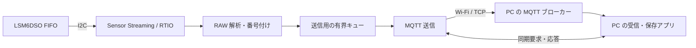

# IMU RAW データ取得・MQTT 配信設計案

## 1. 目的と位置付け

Arduino Nano RP2040 Connect の LSM6DSO から加速度と角速度を取得し、
PC 上のアプリケーションに MQTT で送信する。各軸はセンサーの符号付き
16-bit RAW 整数のまま送る。

この文書は設計案であり、バイナリ形式や時刻同期はまだ実装・検証されていない。
既存の `imu_mqtt_probe` の形式とは互換ではない。実装前に未確定事項を決める。

### 合意済みの要求

- 加速度・角速度とも設定 ODR 6667 Hz、各 3 軸の RAW データを取得する。
- PC に MQTT でバイナリ送信する。PC 上の受信アプリは今後作成する。
- Wi-Fi が切断されても計測は続ける。切断中に送れないデータは破棄してよい。
- PC の時刻との同期を基本とし、誤差が数 ms 以内になることを目標とする。

通信断以外でも無条件に欠落しないことを保証するものではない。FIFO
オーバーラン、通信輻輳、PC の受信停止などは検出・報告する対象とし、
時刻精度や継続性能は実機で検証する。

### これまでの測定

- FIFO の 16-bit RAW を送る QoS 0 の診断版では、PC を 5 GHz に接続した条件で
  120 秒間、受信件数と CRC32 が一致した。この 120 秒測定は NINA 側に TCP
  の実験変更が入った状態である。
- NINA の TCP 実験変更を外した状態でも、同じ経路で 60 秒間の件数と CRC32 の
  一致を確認した。NINA の省電力は無効にしている。
- 上記は専用のテスト受信器による測定であり、下記の提案プロトコル、時刻同期、
  一般的な MQTT ブローカーや PC 録画アプリの性能を確認したものではない。

## 2. 全体構成

PC 上で MQTT ブローカーと受信・保存アプリの両方を動かす案とする。既存の
`script/imu_mqtt_probe.py` は診断専用の簡易受信器であり、汎用ブローカーや
データ保存機能ではない。同期メッセージも MQTT を利用する案だが、測定した
遅延・精度が要件を満たさなければ他の経路を検討する。

FIFO 読み出しと送信は独立させる。Wi-Fi・MQTT の切断や送信待ちで FIFO の
読み出し処理をブロックしない。受信バッファの所有期間を守り、必要な RAW と
時刻情報を送信用バッファにコピーした後、RTIO バッファを解放する。

## 3. RAW 取得

### 3.1 API の責務

1. Zephyr の `sensor_stream()` と RTIO で FIFO watermark ごとにバッファを取得する。
2. LSM6DSO ドライバの RAW 解析 API で、バッファを FIFO 順に解釈する。
3. 加速度または角速度の種類と、各軸の `int16_t` RAW 値を取り出す。
4. サンプル番号を割り当て、送信用バッチに詰める。

取得は Sensor Streaming API、解釈はデバイス固有のドライバ API である。
現在の `lsm6dso_fifo_next()` はドライバ側の関数であり、Streaming API ではない。
現在の `sensor_decode()` は RAW ではなく、スケール済みの固定小数点値を返す。

RAW 解析 API は既存の `lsm6dso_fifo_next()` を基に整理する。現関数は未対応タグを
読み飛ばすため、少なくとも次を区別できるようにする。関数名・型は実装時に確定する。

- 加速度・角速度の RAW データ。
- 有効化した IMU タイムスタンプなどの既知タグ。
- 想定外タグ、破損、バッファ終端。

加速度と角速度が FIFO に交互に入ることや、同じ順序番号が同時刻を意味することは
仮定しない。センサーデータとタイムスタンプの対応付け規則は LSM6DSO の仕様を
確認し、実機で検証する。

### 3.2 サンプル番号とエラー

計測開始ごとに `session_id` を変え、加速度・角速度それぞれの `sample_index` を
0 から始める。番号は送信可否に関係なく、RAW データを FIFO から正常に取得した
時点で付ける。切断中やキュー満杯時に破棄しても番号を進め、再接続後に受信した
番号との差から PC が欠落範囲を検出できるようにする。

FIFO 内で失われたデータの正確な個数は、オーバーラン検出だけからは分からない。
この場合、欠落数を推測して連番を継続しない。エラーと時刻・カウンターの不連続を
通知し、FIFO の回復後は新しいデータ区間（`epoch_id`）を開始する。計測処理は
可能な限り継続するが、回復不能なハードウェアエラーを隠さない。

## 4. 通信と切断時の動作

### 4.1 方針

- MQTT 3.1.1、RAW データは QoS 0、retain なしを初期案とする。
- 1 MQTT PUBLISH のペイロードに、自己完結する 1 データバッチを入れる。
- 送信キューは固定長で、FIFO 処理からの投入は待たない。満杯時は新着バッチを
  破棄し、加速度・角速度それぞれの破棄数と範囲を記録する。
- 切断を検出したら未送信キューを破棄し、再接続までの新着データも破棄する。
  途中まで送信した MQTT メッセージは TCP 接続とともに破棄し、残りだけを再送しない。
- 再接続後は設定・状態を再通知し、新着バッチから送信する。切断前後で
  `session_id` は変えず、バッチ番号と各センサーのサンプル番号も進め続ける。

キュー破棄時の番号と件数の更新は単一の所有者が行い、送信スレッドと競合させない。
Wi-Fi が接続中でもブローカーや PC アプリが停止している場合があるため、接続状態は
Wi-Fi と MQTT で別々に扱う。

QoS 0 は通信中の欠落も許す。PC は受信した連番の飛びで欠落を検出するが、次の
バッチを受信できなければ末尾の欠落範囲は確定できない。ボードが再起動・停電した
場合、再通知前の最終状態も失われ得る。実行中の累積カウンターは復帰後に通知するが、
永続保存や未送信データの再送は本案の対象外である。

QoS 1 は再送・重複処理と資源使用量を増やし、PC アプリが保存したことも保証しない。
まず QoS 0 で検証し、通信中の欠落を減らす必要があれば QoS 1 を別途評価する。

### 4.2 状態遷移

| 状態 | IMU 取得 | RAW の扱い |
|---|---|---|
| 未計測 | 停止 | 送信しない |
| 計測中・MQTT 接続済み | 継続 | キューから送信。満杯時は新着を破棄して記録 |
| 計測中・未接続 | 継続 | 未送信・新着データを破棄して記録 |
| 再接続 | 継続 | 設定・状態を再通知し、新着データを送信 |
| FIFO エラー | 回復を試行 | 個数不明の欠落と新しい epoch を通知 |
| 計測停止 | 停止 | 正常終了またはエラーを通知可能な範囲で送信 |

RAW に適用するバッチ番号は、完成したバッチの送信可否を判断する前に割り当てる。
サンプル番号は FIFO 読み出し時に割り当てる。これにより送信されなかった範囲を
後続データから識別できる。EOF や正常停止を受信していない計測は PC 側で未完了とする。

## 5. MQTT トピック案

`<device_id>` は MQTT のトピック区切り `/` を含まない安定したボード識別子とする。
具体的な生成・設定方法は未決定。

| トピック | 方向 | ペイロード | 初期案 |
|---|---|---|---|
| `imu/<device_id>/raw` | ボード → PC | §6 のバイナリ | QoS 0、retain なし |
| `imu/<device_id>/info` | ボード → PC | 計測設定・セッション情報 JSON | QoS 1、retain あり |
| `imu/<device_id>/status` | ボード → PC | 計測・エラー・累積カウンター JSON | QoS 0、retain なし |
| `imu/<device_id>/sync/request` | PC → ボード | §7 の同期要求 JSON | QoS 0、retain なし |
| `imu/<device_id>/sync/response` | ボード → PC | §7 の同期応答 JSON | QoS 0、retain なし |

`info` には `session_id`、`epoch_id`、センサーモデル、軸順、加速度・角速度の
フルスケールと感度、設定 ODR、RAW 形式・符号・バイト順、IMU 時刻の単位、
同期情報のバージョンを含める。設定変更で意味が変わる場合は新しいセッションを
開始する。実際の ODR は設定値と異なり得るため、設定値を実測値として扱わない。
また、各 `time_map_id` について、対象 `session_id`・`epoch_id` と、IMU tick の
拡張方法、各センサーの時刻を補間するための周期（整数比など精度を失わない表現）、
適用範囲、推定品質を記録する。これらは RAW の `first_tick` 以降の同種ワードの
時刻を復元するために必要であり、公称 ODR から暗黙に決定しない。FIFO 中の時刻
アンカーに基づく補間誤差が許容値を超える場合はバッチを分割するか、該当する時刻を
無効にする。単一周期で復元できること自体も実機検証の対象とする。

`status` には計測状態、接続状態、FIFO オーバーラン、想定外タグ、キュー破棄数、
取得・送信サンプル数、最後の既知の番号、同期状態を含める。送信できない間の状態は
復帰後に累積値を再通知する。`info` の retain は後から参加した PC 用の最新情報であり、
古い retained 情報が生存確認になるわけではない。PC は `session_id` と最新の状態を
照合し、不一致や未受信なら RAW を未解釈として保持する。終了時の retained 情報の
更新、ブローカーの再起動時の再通知、および PC アプリの購読順は実装時に定義する。
時刻換算情報は `time_map_id` ごとに PC で保存する。対応する情報がまだ届いていない
RAW は、推測して時刻変換せず保留または時刻未確定として保存する。retain は最新値
だけなので、途中から参加した受信者や古いバッチに必要な換算情報をどう再取得するかは
未決定であり、本形式を確定する前に解決する。

## 6. RAW ペイロード案 v1

### 6.1 共通規則

- 複数バイトの整数と RAW 値は little-endian。RAW のみ符号付き 2 の補数 `int16`。
- センサーごとの RAW の並びは FIFO から取得した順序とする。
- 1 ワードは X、Y、Z の 3 軸、計 6 バイト。種類は別のビット列に置く。
- 1 PUBLISH はヘッダー、種類ビット列、RAW すべてを含む。PUBLISH 境界をまたがない。
- 計測時の座標軸、実際の full scale、感度は `info` に記載する。

### 6.2 ヘッダー

以下は固定長 **80 バイトの提案**。`uN` は N-bit 符号なし整数。具体的な値や
妥当性検査はプロトコル確定時に固定し、PC・ボードで共通のテストベクトルを用意する。

| オフセット | 型 | 項目 | 意味 |
|---:|---|---|---|
| 0 | bytes[4] | magic | ASCII `IMU1` |
| 4 | u8 | version | `1` |
| 5 | u8 | flags | bit 0: accel 時刻有効、bit 1: gyro 時刻有効。その他は 0 |
| 6 | u16 | header_len | `80` |
| 8 | bytes[16] | session_id | 1 計測を識別する 128-bit 値 |
| 24 | u64 | batch_seq | バッチ連番。セッション内で 0 から |
| 32 | u64 | accel_first_index | このバッチ内の最初の加速度番号 |
| 40 | u64 | gyro_first_index | このバッチ内の最初の角速度番号 |
| 48 | u64 | accel_first_tick | 最初の加速度に対応する拡張 IMU 時刻 |
| 56 | u64 | gyro_first_tick | 最初の角速度に対応する拡張 IMU 時刻 |
| 64 | u16 | word_count | 1〜384 を初期案とする |
| 66 | u16 | bitmap_len | `ceil(word_count / 8)` |
| 68 | u32 | epoch_id | FIFO 回復・時刻不連続ごとに更新 |
| 72 | u32 | time_map_id | 使用する IMU 時刻の換算情報の識別子 |
| 76 | u32 | reserved | `0` |

このバッチに存在しない種類の `first_index` は `UINT64_MAX`、対応する
`first_tick` は `0`、時刻有効 bit は 0 とする。種類は存在するが時刻を復元できない
場合も、その種類の時刻有効 bit は 0、tick は 0 とする。`first_tick` はセンサーの
時刻ドメインであり、PC の Unix 時刻ではない。tick 単位、ラップ解除、サンプル時刻の
補間は §7 で扱う。番号・時刻が同時に有効であるとは限らない。

### 6.3 種類ビット列と RAW

ヘッダーに続く `bitmap_len` バイトのビット `i % 8` はワード `i` の種類を示し、
`0` が角速度、`1` が加速度。使用しない最終バイトの上位ビットは 0。続く
`word_count × 6` バイトに各ワードの `x, y, z` を順に格納する。

受信側は magic、version、長さ、予約領域、フラグ、bitmap の未使用 bit と、
`payload_len == 80 + bitmap_len + 6 × word_count` を検査する。範囲外や未対応
version は誤解釈せず拒否する。シーケンス・セッション・epoch の検査も行う。

初期案の 384 ワードは 48 バイトのビット列と 2,304 バイトの RAW となり、
ヘッダーを含め **2,432 バイト**。加速度と角速度がともに 6667 Hz のとき、
約 28.8 ms 分に相当する。最大までたまらない場合は上限待ち時間で端数を送る。
値は実測で見直す。ヘッダー込みの平均ペイロード量は約 0.68 Mbit/s で、これに
MQTT・TCP・Wi-Fi 等のオーバーヘッドが加わる。

### 6.4 セッション識別

`session_id` は再起動後も過去の計測と衝突しない必要がある。PC が計測開始時に
割り当てる方式、またはボードの安定 ID と永続化した起動／計測カウンターを組み合わせる
方式を候補とする。現在のテスト用乱数設定を、衝突しない ID の保証に使わない。
PC 不在時の計測開始を許すかを含めて実装前に決める。

## 7. PC 時刻との同期

### 7.1 時刻の分離

次の 3 つを混同しない。

1. **IMU 時刻**：センサーのタイムスタンプとサンプル番号。センサーごとのサンプル位置を表す。
2. **ボードの単調時刻**：RP2040 上の、時刻補正で逆行しない高分解能カウンター。
3. **PC 時刻**：PC の単調時刻と、表示・保存用のリアルタイム時刻（Unix 時刻）。

IMU → ボード単調時刻、ボード単調時刻 → PC 単調時刻、PC 単調時刻 → PC
リアルタイム時刻の対応を保持する。単一のオフセットだけで長時間の周波数差を無視せず、
複数の対応点からドリフトを推定する。PC の時刻変更を検出したら変換区間を分ける。
各対応点、推定方法、品質、世代 ID を保存し、後から再計算できるようにする。

### 7.2 IMU → ボード

LSM6DSO のハードウェアタイムスタンプを FIFO に含め、センサーデータとの位置関係を
解析する。現在のドライバは FIFO タイムスタンプを有効にしておらず、読み出し後の
ホスト時刻からサンプル時刻を推定している。RAW API にタイムスタンプタグを追加し、
FIFO 内の位置関係、頻度、カウンターのラップ・リセット、ODR と感度設定を扱う。

IMU カウンターの読み取り前後にボード単調時刻を記録し、対応の不確かさを見積もる。
FIFO タイムスタンプとセンサーデータの正確な関係、読み取り処理の遅延、内部発振器の
補正値の適用方法は仕様確認・実測が必要。加速度と角速度の先頭 tick を常に有効に
できると仮定せず、未確定なら時刻無効フラグで送る。タイムスタンプを追加すると FIFO
の負荷と通信量が増えるため、6667 Hz で改めて検証する。

### 7.3 ボード → PC

PC が一定間隔で同期要求を送り、PC 送信時刻 `t1`、ボード受信・応答時刻 `t2, t3`、
PC 受信時刻 `t4` をそれぞれの単調時刻で記録する案とする。要求 ID、セッション／
起動識別子を付けて対応する応答のみ使う。PC は往復時間を評価し、遅延の大きい
サンプルを除外しながら複数の観測から変換と品質を推定する。

MQTT ブローカーを経由した場合、キューイングやスレッド処理、Wi-Fi の往復経路の非対称
遅延が入る。**小さい往復時間や推定されたオフセットだけでは数 ms 以内を保証できない。**
タイムスタンプを取る正確な位置、同期間隔、外れ値除外、ドリフト推定、許容する
不確かさは実測後に決める。実機で達成できなければ、同期専用の直接通信や
ハードウェア信号を検討する。

### 7.4 未同期・切断中

同期前、同期情報が古い期間、PC 時刻が変化した期間は、取得を止めず品質を
`unsynchronized` または `degraded` として扱う。切断中のデータは破棄されるが、
IMU とボードの時刻は継続して追跡する。再接続後は同期を再取得し、十分な観測を
得るまで数 ms 以内と表示しない。品質の期限や誤差推定の具体的な閾値は実測後に決める。

## 8. 検証計画

1. **RAW 単体**：正負・上下限の 16-bit 値、加速度／角速度の混在、複数バッチに
   またがる順序、想定外タグ、RTIO バッファ解放を検証する。
2. **プロトコル**：端数、384 ワード、符号・little-endian、長さ不正、未知バージョン、
   予約 bit、各センサー不在、重複・欠落・順序不整合を PC とボード共通のテストベクトルで検証する。
3. **性能**：実際の MQTT ブローカーと PC アプリを使い、6667 Hz、タイムスタンプを
   有効にして長時間測る。取得数、FIFO エラー、破棄数、PC の受信数、CPU・メモリ、
   キュー最大使用量を記録する。時間と許容エラーの合格条件は実装前に決める。
4. **切断・輻輳**：Wi-Fi 切断、ブローカー停止、PC アプリ停止、キュー満杯を個別に
   発生させ、取得継続、番号の飛び、破棄数、復帰、末尾不明の扱いを確認する。
5. **時刻**：別の基準でセンサーイベントと PC 時刻の差を観測し、無負荷・高負荷・
   長時間・再接続・PC 時刻変更時の誤差分布と最大値を測る。推定品質が悪い場合に
   未同期として扱うことも確認する。数 ms 以内と判定する具体的な数値、基準器、
   許容割合は検証前に決める。

## 9. 未決定事項

- 数 ms の上限値と、最大誤差・百分位数・測定時間などの合格条件。
- セッション ID の生成方法と、PC 不在時に計測開始できるか。
- FIFO タイムスタンプの頻度とサンプルへの対応、時刻換算の精度・通信方式。
- キュー容量、バッチの最大待ち時間、状態通知の周期。
- PC 受信アプリの保存形式と、ブローカー・アプリ停止をどう検出するか。
- 計測開始／停止・設定の操作経路、認証・暗号化を必要とする利用環境。

## 参考資料

- [Zephyr Read and Decode](https://docs.zephyrproject.org/latest/hardware/peripherals/sensor/read_and_decode.html)
- [Zephyr Time Utilities](https://docs.zephyrproject.org/latest/kernel/timeutil.html)
- [ST LSM6DSO データシート](https://www.st.com/resource/en/datasheet/lsm6dso.pdf)
- [ST LSM6DSO アプリケーションノート AN5192](https://www.st.com/resource/en/application_note/an5192-lsm6dso-alwayson-3d-accelerometer-and-3d-gyroscope-stmicroelectronics.pdf)
- [OASIS MQTT 3.1.1](https://docs.oasis-open.org/mqtt/mqtt/v3.1.1/os/mqtt-v3.1.1-os.html)
