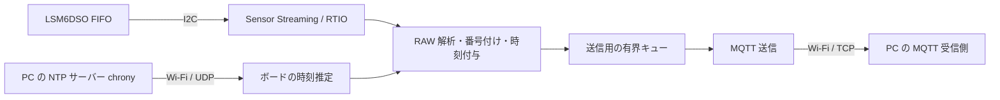

# IMU RAW データ取得・MQTT 配信の設計

[English](imu-raw-mqtt-design.md) | 日本語

## 1. 目的と位置付け

Arduino Nano RP2040 Connect の LSM6DSO から加速度と角速度を取得し、
PC 上のアプリケーションに MQTT で送信する。各軸はセンサーの符号付き
16-bit RAW 整数のまま送る。

この文書は、2026-11-12 時点の実装（`zephyr/app/usb-console`、PC 側の `host/`）の設計と、実機で確認できた範囲・
できていない範囲を記す。全体はまだ実験段階で、ペイロード形式やトピックは実装済みだが
確定ではなく、PC 側の専用アプリの仕様に合わせて見直す前提である。使い方は
[README](../README_ja.md) を参照。
NuttX 13.1.0 に移植した版（`nuttx/`）の設計上の違いは §11 に記す。

### 合意済みの要求

- 加速度・角速度とも設定 ODR 6667 Hz、各 3 軸の RAW データを取得する。
- PC に MQTT でバイナリ送信する。PC 上の受信アプリは今後作成する。
- Wi-Fi が切断されても計測は続ける。切断中に送れないデータは破棄してよい。
- PC の時刻との同期を基本とし、誤差が数 ms 以内になることを目標とする。

通信断以外でも無条件に欠落しないことを保証するものではない。FIFO
オーバーラン、通信輻輳、PC の受信停止などは検出・報告する対象とする。

### 実装状況の概要

| 項目 | 状態 |
|---|---|
| RAW 取得・番号付け・バッチ化 | 実装済み |
| MQTT 送信（QoS 0）、切断中の破棄、再接続 | 実装済み |
| info / status 通知 | 実装済み（実験的な JSON） |
| FIFO エラー後の回復と `epoch_id` | 実装済み（注入したオーバーランのみ実機確認） |
| センサー時刻（tick）の付与 | 実装済み |
| PC 時刻との同期、バッチへの PC 時刻の付与 | 実装済み（NTP、ペイロード v2） |
| 計測の開始・停止 | シェルの `imu start` / `imu stop`（PC から操作する経路は未実装） |
| セッション ID・接続先 | 実装済み（自動採番、既定はデフォルトゲートウェイ、KV で変更） |
| 校正値の算出と、ボードの `sensor get` / `stream` への適用 | 実装済み（§10） |
| PC 側の受信・保存アプリ | 一部実装（`host/ImuStudio`：受信、校正の適用、姿勢・スペクトル・位置の表示、記録と再生） |
| 実際の MQTT ブローカーでの運用 | 未検証 |

### 実機で確認した範囲

条件は特記しない限り、加速度・角速度とも 6667 Hz、FIFO watermark 128、I²C 1 MHz、
タイムスタンプ decimation 8、UGREEN の USB アダプターを PC 上で AP にした 2.4 GHz 接続、
受信は `imu-host check`（試験時は、同じ処理の移行前のスクリプト）。**各試験は 1 回ずつ**であり、長期の保証ではない。

- 30 分連続：63128 バッチで欠番 0、全バッチに PC 時刻、時刻の逆行 0、FIFO オーバーラン 0。
- 受信器の停止（6 秒）、受信側の読み出し停止によるキュー満杯、AP の停止（約 50 秒・
  約 86 秒）：いずれも IMU 取得は継続し、ボードの破棄数と PC 側の欠番が整合した。
- 注入した FIFO オーバーラン：新しい epoch で自動再開し、計測は継続した。
- 時刻：ボードの推定時刻は USB 経由の照合で PC 時刻に対し −2.3〜+0.6 ms の範囲
  （30 分間安定）。chrony の停止（約 90 秒）と AP 断の後も時刻は逆行しなかった。

未確認の主な点は §8 と §9 にまとめる。校正の確認結果は §10.6 にある。

### ビルドとホストテスト

```sh
cd zephyr
west build -b arduino_nano_connect app/usb-console -d build/usb-console
./script/host_tests.sh
```

構成は `prj.conf` の 1 つで、RAW 送信と時刻付与は常に含まれる。ホストテストは
`fifo_words`、`imu_raw_packet`、`imu_raw_batch`、`imu_raw_queue`、`imu_raw_status`、
`imu_raw_time`、`imu_tick_clock`、`time_offset`、`lsm6dso_cal`、`lsm6dso_zero` などが対象の機能を検証する。

## 2. 全体構成



| 役割 | 実装 |
|---|---|
| FIFO ワードの解析 | `drivers/lsm6dso/lsm6dso_fifo.*` |
| バッチ化・番号付け・epoch | `src/imu_raw_batch.*` |
| ペイロードの組み立て | `src/imu_raw_packet.*` |
| FIFO タイムスタンプ → サンプルの tick | `src/imu_raw_time.*` |
| tick → ボードの時計 | `src/imu_tick_clock.*` |
| ボードの時計 → PC 時刻 | `src/time_sync.*`、`src/time_offset.*` |
| 送信キュー | `src/imu_raw_queue.*` |
| MQTT 送信・再接続・status / info | `src/imu_raw_mqtt.*`、`src/imu_raw_status.*` |
| 取得スレッド・回復・シェル（`imu`） | `src/imu_stream.c` |
| NINA のソケット | `drivers/nina/nina_socket.c`（[ドライバーの説明](../zephyr/app/usb-console/drivers/README_ja.md)） |

FIFO 読み出しと送信は独立している。Wi-Fi・MQTT の切断や送信待ちで FIFO の読み出しを
ブロックしない。スレッドの優先度は、計測（バッチ化）と時刻同期が 9、FIFO の読み出し
ワーカーが 10、MQTT 送信が 11。送信側は、キューの排他（mutex）以外で取得側を待たせない。

PC 側は現状、`host/` の `imu-host` が MQTT クライアント 1 台を直接受け付ける。検証用の受信
（`check`）と校正（§10）のためのツールで、汎用ブローカーでも常時の受信・保存アプリでもない。
使い方は [`host/README_ja.md`](../host/README_ja.md) を参照。

## 3. RAW 取得

### 3.1 取得と解析

1. Zephyr の `sensor_stream()` と RTIO で FIFO watermark ごとにバッファを取得する。
2. `lsm6dso_fifo_buffer_words()` でバッファから FIFO のワードを取り出し、
   `lsm6dso_fifo_next_entry()` で FIFO 順に解釈して、加速度・角速度のサンプル、タイムスタンプ、
   それ以外のタグを区別する。各ワードの 2-bit タグカウンターと、タイムスタンプのワードが持つ
   カウンター値も取り出す。バッファの先頭のヘッダーとワードの中身の形式を知っているのは
   ドライバーだけで、計測側はこの 2 つの関数の結果だけを使う。
3. サンプルに番号を割り当て、最大 384 ワードのバッチに詰める。
4. バッチが満杯になるか、最後の追加から 100 ms 経つと送信キューへ渡す。

加速度と角速度が FIFO に交互に入ることは仮定せず、種類はワードごとのビット列で運ぶ。

### 3.2 サンプル番号・バッチ番号・epoch

- 計測ごとに `session_id` を与え、加速度・角速度それぞれの番号とバッチ連番を 0 から始める。
- 番号は送信可否に関係なく、FIFO から取得した時点で付ける。切断中やキュー満杯で破棄しても
  番号は進むので、PC は受信した番号の飛びから欠落範囲を検出できる。
- FIFO オーバーランなど、**失われた個数が分からない**不連続では `epoch_id` を 1 進める。
  番号はセッション内で一意になるよう進み続けるが、epoch の境界では番号が連続していても
  サンプルは連続していない。

### 3.3 FIFO エラー後の回復

ドライバーは、FIFO オーバーラン、バッファ不足、I²C エラーを検出すると FIFO を止めて
ストリームをエラーで終える。計測スレッドはそれを受けて、集めた分を送り、epoch を進め、
ストリームを開始し直す。次の場合は回復を諦め、エラーで計測を終える。

- センサーの FIFO を停止できなかった。
- 再開してもデータが届かないまま 3 回続けて失敗した。

想定外のタグを含むパケットは、その残りを捨てて epoch を進め、計測を続ける。
回復は、FIFO 処理を意図的に止める試験用コマンドでオーバーランを起こして確認した。
このコマンドは整理の際に削除したので、現在の実機では再現できない。I²C 障害、回復を
諦める経路、想定外タグは実機で発生させていない。

## 4. 通信と切断時の動作

### 4.1 方針

- MQTT 3.1.1、RAW データは QoS 0、retain なし。
- 1 PUBLISH のペイロードに、自己完結する 1 バッチを入れる。
- 送信キューは 12 バッチ（約 0.35 秒分）の固定長で、FIFO 処理からの投入は待たない。満杯時は新着バッチを
  破棄し、破棄したバッチ数と加速度・角速度のサンプル数を数える。
- 未接続の間は、キューの中身と新着バッチを破棄する。送信に失敗したバッチは再送しない。
- 切断後は 1 秒間隔で再接続を試み、再接続したら info と status を再通知して新着バッチから
  送る。切断前後で `session_id` は変えず、番号は進め続ける。

QoS 0 なので、ボードが送信済みと数えたバッチが届かないことがある（切れかけの接続に
書き込まれた分）。実機の切断試験では 1〜19 バッチの差が出た。PC は連番の飛びで検出できるが、
次のバッチを受信できなければ末尾の欠落範囲は確定できない。

AP が消えた直後は、送信が最大約 9 秒ブロックしてから切断として認識された。その間は
「接続中のキュー満杯」として破棄される。取得には影響しない。

### 4.2 送信先と開始時の動作

送信先は KV の `imu.host`・`imu.port`（既定はデフォルトゲートウェイの 1883 番）。`imu.host` が
ない場合、接続を試みるたびにデフォルトゲートウェイを引き直すので、Wi-Fi に繋がる前でも
計測を開始でき、別の AP に移ればその AP の PC へ接続する。

`imu start` は最初の接続を最大 3 秒待ってから取得を始める。待っても繋がらなければ取得だけ
始め、繋がるまでのバッチは破棄して数える。

### 4.3 状態遷移

| 状態 | IMU 取得 | RAW の扱い |
|---|---|---|
| 未計測 | 停止 | 送信しない |
| 計測中・MQTT 接続済み | 継続 | キューから送信。満杯時は新着を破棄して記録 |
| 計測中・未接続 | 継続 | 未送信・新着データを破棄して記録 |
| 再接続 | 継続 | info / status を再通知し、新着データを送信 |
| FIFO エラー | 自動で再開 | epoch を進める（個数不明の欠落） |
| 計測停止 | 停止 | 残りを送り、`stopped` の status を送信 |

## 5. MQTT トピック

`<device_id>` は英数字・`-`・`_` のみの識別子で、KV の `imu.device`（既定 `rp2040`）で決まる。

| トピック | 方向 | ペイロード | QoS / retain | 状態 |
|---|---|---|---|---|
| `imu/<device_id>/raw` | ボード → PC | §6 のバイナリ | QoS 0、なし | 実装済み |
| `imu/<device_id>/info` | ボード → PC | 計測設定の JSON | QoS 1、あり | 実装済み |
| `imu/<device_id>/status` | ボード → PC | 状態・カウンターの JSON | QoS 0、なし | 実装済み |

### 5.1 info

計測開始時、再接続時、FIFO エラーから再開したときに送る。QoS 1 だが、PUBACK が来なくても再送は
しない（次の再接続か変更時に送り直す）。

| 項目 | 意味 |
|---|---|
| `v` | この JSON の版（1） |
| `session`、`epoch`、`device` | セッション ID（32 桁 hex）、epoch、デバイス ID |
| `sensor`、`payload`、`payload_version`、`raw`、`axes` | `LSM6DSO`、`IMU1`、`2`、`int16le`、`xyz` |
| `accel_odr_hz`、`gyro_odr_hz` | 設定 ODR（実測値ではない） |
| `accel_ug_per_lsb`、`gyro_udps_per_lsb` | 感度。レンジは `app.overlay` で加速度 ±8 g、角速度 ±2000 dps にしており、値は 244 と 70000 |
| `fifo_watermark`、`timestamp_decimation` | FIFO の設定 |
| `time`、`tick_hz_nominal`、`freq_fine` | tick の種別（`sensor_tick`）、公称 40000 Hz、センサーの周波数補正値 |

`freq_fine` から求まる tick の速さは目安であり、実測値とは一致しない（§7.2）。

### 5.2 status

接続・再接続時、状態の変化時、および 1 秒周期で送る。切断中の分は保持せず、再接続後に
累積値が届く。

| 項目 | 意味 |
|---|---|
| `state` | `idle` / `measuring` / `stopped` |
| `accel`、`gyro`、`next_batch`、`timestamp_words` | 取得した数と次のバッチ番号（送信可否と無関係） |
| `fifo_overruns`、`i2c_errors`、`raw_error`、`error` | 取得側のエラー |
| `dropped_batches`、`dropped_accel`、`dropped_gyro` | 送信側で破棄した数 |
| `published`、`connects`、`failures`、`queue_high` | 送信数（到達数ではない）、接続回数、失敗数、キュー最大使用量 |
| `tick`、`tick_mono_us`、`tick_window_us` | センサーの tick とボードの時計を同時に読んだ対応点（§7.2） |
| `unix_us`、`unix_estimate_us`、`sync_delay_us` | その時点の PC 時刻の推定（寄せた値・生の値）と、根拠にした NTP の往復時間 |
| `sync` | `ntp` / `unsynchronized` |

## 6. RAW ペイロード（バージョン 2）

### 6.1 共通規則

- 複数バイトの整数と RAW 値は little-endian。RAW のみ符号付き 2 の補数 `int16`。
- センサーごとの RAW の並びは FIFO から取得した順序とする。
- 1 ワードは X、Y、Z の 3 軸、計 6 バイト。種類は別のビット列に置く。
- 1 PUBLISH はヘッダー、種類ビット列、RAW すべてを含む。PUBLISH 境界をまたがない。

### 6.2 ヘッダー（96 バイト）

オフセット 0〜79 はバージョン 1 と同じ配置で、80 以降がバージョン 2 の追加である。

| オフセット | 型 | 項目 | 意味 |
|---:|---|---|---|
| 0 | bytes[4] | magic | ASCII `IMU1` |
| 4 | u8 | version | `2` |
| 5 | u8 | flags | 下表 |
| 6 | u16 | header_len | `96` |
| 8 | bytes[16] | session_id | 1 計測を識別する 128-bit 値 |
| 24 | u64 | batch_seq | バッチ連番。セッション内で 0 から |
| 32 | u64 | accel_first_index | このバッチ内の最初の加速度番号 |
| 40 | u64 | gyro_first_index | このバッチ内の最初の角速度番号 |
| 48 | u64 | accel_first_tick | 最初の加速度のセンサー時刻（64-bit に拡張した tick） |
| 56 | u64 | gyro_first_tick | 最初の角速度のセンサー時刻 |
| 64 | u16 | word_count | 1〜384 |
| 66 | u16 | bitmap_len | `ceil(word_count / 8)` |
| 68 | u32 | epoch_id | 個数不明の欠落ごとに 1 進む |
| 72 | u32 | time_map_id | 未使用（常に 0） |
| 76 | u32 | reserved | `0` |
| 80 | u64 | accel_first_unix_us | 最初の加速度の PC 時刻（1970 年からの µs） |
| 88 | u64 | gyro_first_unix_us | 最初の角速度の PC 時刻 |

| flags | 意味 |
|---|---|
| bit 0 | `accel_first_tick` が有効 |
| bit 1 | `gyro_first_tick` が有効 |
| bit 2 | `accel_first_unix_us` が有効（bit 0 が必要） |
| bit 3 | `gyro_first_unix_us` が有効（bit 1 が必要） |
| その他 | 0 |

このバッチに存在しない種類の `first_index` は `UINT64_MAX`。無効な tick・PC 時刻は 0 で、
値ではなくフラグで有効性を判定する。

### 6.3 種類ビット列と RAW

ヘッダーに続く `bitmap_len` バイトのビット `i % 8` はワード `i` の種類を示し、
`0` が角速度、`1` が加速度。使用しない最終バイトの上位ビットは 0。続く
`word_count × 6` バイトに各ワードの `x, y, z` を順に格納する。

受信側は magic、version、長さ、予約領域、フラグ、bitmap の未使用 bit と、
`payload_len == 96 + bitmap_len + 6 × word_count` を検査し、範囲外や未対応 version を
誤解釈せず拒否する。`host/imu_host/packet.py` がこの検査を行う。

384 ワードのバッチは 48 バイトのビット列と 2,304 バイトの RAW を持ち、ヘッダーを含め
**2,448 バイト**。加速度と角速度がともに 6667 Hz のとき約 28.7 ms 分で、毎秒約 35 バッチ、
ペイロード量は約 0.68 Mbit/s になる。

### 6.4 受信側での時刻の扱い

- バッチの先頭サンプルの時刻は、有効フラグが立っていれば `*_first_unix_us` をそのまま使う。
- バッチ内の 2 番目以降は、次のバッチの先頭時刻との間をサンプル番号で等分する。
- PC 時刻が無効なバッチも tick は持つので、前後の有効なバッチや status の対応点から補える。
- tick の速さを固定値として扱わない。センサーの発振器は公称値から 0.55% ずれており、
  30 分の間にも約 70 ppm 変動した。

### 6.5 セッション識別

`session_id` は `imu start` のたびに自動で割り当てる。先頭 8 バイトがチップ固有の ID、続く
4 バイトが KV に保存した通し番号（big-endian）、残りは 0 である。通し番号は開始前に保存する
ので、再起動や電源断をまたいでも同じ ID は使われない。KV の領域を消去すると通し番号は
1 に戻る。

## 7. 時刻

### 7.1 3 つの時計

1. **センサーの tick**：LSM6DSO 内部のタイムスタンプカウンター。公称 25 µs。
2. **ボードの時計**：RP2040 の 1 MHz ハードウェアタイマー。補正で書き換えない。
3. **PC 時刻**：PC の実時間（Unix 時刻）。chrony が提供する。

ボードの時計に Zephyr のカーネル時計（`k_uptime`、`k_cycle`）は使わない。カーネル時計は
SysTick で動いており、アイドル時は正確だが、6667 Hz 送信中は約 480 ppm 遅れた
（122 秒で −59 ms）。原因は調べていない。`imu status` の `elapsed_ms` はボードの時計に
よる値だが、`kernel uptime` や status の `uptime_ms` はカーネル時計なので、送信中は
同程度ずれ得る。

### 7.2 センサーの tick とボードの時計

**サンプルへの tick の対応付け。** センサーは同じ瞬間のワードに同じ 2-bit のタグカウンターを
付け、カウンターは瞬間ごとに 1 進む。タイムスタンプのワードは、同じカウンターを持つ直後の
サンプル群の時刻を表す。これは decimation 8 の実機で観測した規則で、実行時にも検査して
逸脱を数える。タイムスタンプ直後のサンプルにはその値を使い、それ以降は直近 2 つの
タイムスタンプの間隔から求めた 1 瞬間あたりの tick 数で進める。間隔が整数 tick で
割り切れない、カウンターが飛んだ、などの場合は tick を無効にする。32-bit のカウンターは
約 30 時間で一周するので 64-bit に拡張する。

1 つのタイムスタンプだけでは、古い値や壊れた値と区別できない。そこで tick は、根拠にした
タイムスタンプが次のタイムスタンプと整合した時点で有効とする（バッチを送る時点で判定する
ので、バッチの先頭サンプルの tick も通常は有効になる）。タイムスタンプが一周でもないのに
巻き戻った場合は、カウンターの再始動として扱い、それ以前に求めた tick は使わない。

6667 Hz・decimation 8 では、タイムスタンプの間隔は常に 48 tick・8 サンプルで、
1 サンプルは 6 tick だった。

**tick とボードの時計の対応付け。** 計測中は 1 秒ごとに、センサーのタイムスタンプレジスタを
I²C で読み、その前後でボードの時計を読む（読み取りは 0.1〜0.4 ms）。この対応点を直近
16 個保持し、最も古い点と新しい点から tick の速さを実測して、tick をボードの時計に変換する。

- 実測した速さは毎秒約 40219 tick（1 tick 24.864 µs）で、公称より 0.55% 速く、
  `freq_fine` から計算した値とも 0.05% 違った。
- 速さを実測できるまで（計測開始から約 1 秒）は、前回の計測の実測値、それもなければ
  `freq_fine` から求めた値を使う。
- 変換結果が直前の結果より前になる場合は、直前の値の直後に留める（逆行させない）。
- 読み取った値は FIFO のタイムスタンプと照合し、それより前、または 2 秒以上先の値は
  対応点にしない。前の対応点とつながらない値（1 tick が 23〜27 µs の範囲に収まらない）が
  来たら、そこから取り直す。対応点から大きく離れた tick（5 秒以上先、20 秒以上前）は
  変換しない。1 つの異常値で、逆行を防ぐ仕組みが以後の時刻を抑え込まないようにするためである。

書き込み直後の最初の計測では、レジスタの最初の読み取りが古い値を返すことがあった
（再起動だけでは起きなかった。原因は調べていない）。上の照合はこれを捨てる。

tick が、センサーが実際にサンプリングした瞬間とどう対応するか（センサー内部の遅れ）は
測定していない。

### 7.3 ボードの時計と PC 時刻

ボードは NTP 形式で PC に問い合わせる。問い合わせ先は既定でデフォルトゲートウェイ
（AP になっている PC）で、`CONFIG_NINA_NTP_SERVER` で固定のサーバーも指定できる。
公開サーバーへの同期はやめた。PC には chrony を導入し、AP 側のサブネットからの
問い合わせを許可する（`allow 10.42.0.0/24`、`local stratum 10`）。

- 2 秒ごと（`CONFIG_NINA_NTP_INTERVAL_MS`）に問い合わせ、応答は 1 ms 間隔で確認する。
- 直近 8 回のうち往復が最短の応答を、ずれの推定に使う。往復の非対称による誤差は
  往復時間の半分が上限なので、短い応答ほど確かである。
- ドリフトは、8 回ごとの最短応答どうしの変化から求める。
- 60 秒応答がなければ、推定を無効とする。Wi-Fi の再接続時は推定を取り直す。

**逆行しない時計。** 推定は、使う応答が入れ替わるたびに前後へ数 ms 飛ぶ。バッチに付ける
時刻やボード内で使う時刻は、推定をそのまま使わず、最大 ±500 ppm の速さで寄せた時計から
求める。この時計は連続で、必ず増える。差が 0.5 秒以上あるとき（初回、PC の時計が飛んだ
とき）だけ即時に合わせる。カーネルの実時間時計（`date`）は前にしか動かさない。

**確認できた精度。** USB でボードに 1 バイト送り、ボードが即座に返す推定時刻を、PC の
送信時刻と受信時刻で挟む照合を行った（照合用のコマンドは整理の際に削除した）。30 分・30712 回の照合で範囲外は
0 回、推定時刻は送信時刻の 0.15〜0.57 ms 後、受信時刻の 1.4〜2.3 ms 前に最も近づいた。
誤差が試験中一定だったとすれば、−2.3〜+0.6 ms の範囲にあったことになる。Wi-Fi とは
別の経路での確認であり、往復の非対称による偏りも含む上限である。

NTP の往復時間は、送信中で中央値 約 7 ms、推定に使われた応答は 4〜6 ms だった。

**採用しなかった方式。** MQTT 経由の同期要求・応答は、実験した結果、送信中の往復が
中央値 約 30 ms で数百 ms の裾があり、受信確認を細かくすると CPU 負荷が 84% まで上がった。

### 7.4 同期が取れていないとき

同期前や、60 秒以上 NTP の応答がない間は、バッチの PC 時刻を無効（フラグなし）にする。
取得と tick の付与は続く。chrony を約 90 秒止めた試験では、約 30 秒分のバッチが無効になり、
再開後は最大 2 ms 程度の補正を寄せて適用し、時刻は逆行しなかった。AP を約 86 秒落とした
試験でも、復帰後の時刻は切断前より前に戻らず、前後の整合は 1.4 ms 以内だった。

## 8. 検証

| 項目 | 状態 |
|---|---|
| RAW 単体・ペイロード形式（ホストテスト） | 済み |
| 連続送信（10 分、30 分） | 済み（各 1 回） |
| 受信器の停止、キュー満杯、AP 断 | 済み（各 1 回） |
| FIFO オーバーランからの回復 | 済み（注入による） |
| I²C 障害、回復を諦める経路、想定外タグ | 未（実機で発生させていない） |
| 時刻：ボードの時計 ⇔ PC（USB 照合） | 済み（−2.3〜+0.6 ms の範囲） |
| 時刻：センサー内部の遅れ | 未（物理的な基準が必要） |
| 時刻：同期切れ、Wi-Fi 再接続 | 済み（各 1 回） |
| 6667 Hz・decimation 8 以外の設定、加速度と角速度で異なる ODR | 未 |
| 開始・停止の繰り返し、リブート後の再開 | 未 |
| 実際の MQTT ブローカー、数時間以上の運用 | 未 |
| 校正：合成データでの復元、実機の記録 2 つでの相互検証 | 済み（§10.6） |
| 校正：角速度の再現性、温度の影響、±8 g・±2000 dps 以外のレンジ | 未 |
| 校正値の書き込み（Telnet、USB）、レンジ変更時の切り替え、起動時の読み込み | 済み（各 1 回） |
| 角速度のバイアスの追従（記録の再生、計測中、`sensor stream`、`imu cal zero`） | 済み（§10.5） |
| 角速度のバイアスの追従：動かしながらの実機確認、範囲外の拒否 | 未（記録の再生とホストテストのみ） |

負荷の目安として、時刻付与まで含めた 6667 Hz 送信中の `cpu_active` は 62〜66% だった
（診断用の USB 照合を並行させると約 72%）。

## 9. 未決定事項

- 計測の開始・停止・設定を PC から操作する経路。現状はシェルの `imu start` / `imu stop` のみ。
- セッション ID を PC 側から指定する必要があるか（現状はボードが自動採番）。
- info / status の項目と周期、retain した info の更新規則。現状は実験的な JSON である。
- `time_map_id` を使うか。現状はバッチに PC 時刻を直接付けており、未使用。
- センサー内部の遅れをどう扱うか（データシートの値を採用するか、測定するか）。
- PC 受信アプリの保存形式と、認証・暗号化を必要とする利用環境。
- PC 側で RAW に校正を掛けるときの角速度のバイアス。ボードは自分の出力用に静止時の値へ
  追従するが（§10.5）、RAW には反映しない。
- 静止の判定のしきい値（0.3 dps、2 mg）と、採用する範囲（1 dps）の妥当性。
- 温度の扱い。RAW に温度がなく、校正値は校正時の温度のものである。
- 回転の不足を判定するしきい値（500 度）と目安（1000 度）の妥当性。

## 10. 校正と物理量への変換

MQTT で送るのは RAW のままで、校正は掛けない。校正値は PC 側で求め、PC 側で RAW に掛けるか、
ボードに書き込んで `sensor get` / `sensor stream` の出力に適用する。使い方は
[`host/README_ja.md`](../host/README_ja.md) を参照。

### 10.1 校正値の算出

- 方法は多姿勢法（Tedaldi らの方法）で、[imu_tk](https://bitbucket.org/alberto_pretto/imu_tk/) を
  Docker で実行する。基準器は使わない。静止時の加速度の大きさが重力に等しいこと、姿勢の間の
  回転が角速度の積分に等しいことから、加速度と角速度それぞれのスケール、軸のずれ、バイアスを
  求める。
- 記録は本番と同じ 6667 Hz で取り、間引かずに渡す。imu_tk の「各静止区間から使うサンプル数」と
  「静止判定の窓」はサンプル数で指定するため、どちらも約 1 秒（6667）にする。角速度の最適化の
  初期スケールは info の感度から決める。これらはイメージのビルド引数で、
  [owhinata/ubuntu-imu_tk](https://github.com/owhinata/ubuntu-imu_tk) のコミットを固定して
  ビルドする。
- 入力は LSB のまま、時刻はセンサーの tick から作る。tick の速さは公称値から約 0.5% ずれて
  おり、公称値を使うとその分が角速度のスケールの誤差になる。そのため status の対応点（tick と
  ボードの時計）から実測する。NTP の同期は要らない。
- 欠落、epoch の変化、飽和のある記録は使わない。姿勢の間の欠落は積分を壊すためである。
- **姿勢を変えるときの回転が 3 軸に行き渡っている必要がある。** 重力と同じ軸まわりの回転は、
  加速度から見て姿勢が変わらず、情報にならない。そこで、各軸の回転に sin（その軸と重力の
  なす角）を掛けて積算した値を表示し、500 度に満たない軸があれば警告する
  （目安は各軸 1000 度以上）。この 2 つの値は、手元の記録から決めた暫定値である。

### 10.2 ボードでの変換

RAW から物理量への変換は、校正の有無にかかわらず 1 つの関数で行う
（`drivers/lsm6dso/lsm6dso_cal.c`）。FIFO のデコーダーと単発読み出しの両方がこれを使う。

```text
out = M · (raw − bias)
```

| 値 | 表現 |
|---|---|
| `M`（3×3） | スケールと軸のずれをまとめた行列。出力の単位あたり 14 ビットの小数を付けた int32 |
| `bias` | LSB に 8 ビットの小数を付けた int32 |
| 途中の和 | int64 |
| `out` | Q31（shift 9）。1 単位は 2⁻²² m/s² または rad/s |

浮動小数点は使わない。係数の整数化は PC 側で行う。丸めによる誤差は 1 LSB の 0.2% 以下で、
センサーのノイズ（6667 Hz で加速度 約 5 mg、角速度 約 1.7 dps の RMS）より十分小さい。
校正値がないときは、公称感度を対角に置いた行列とバイアス 0 で同じ関数を通す。

### 10.3 校正値の保存と選択

校正値は KV に、センサーと感度ごとのキーで置く。

```text
imu.cal.accel.<µg/LSB>      imu.cal.gyro.<µdps/LSB>
```

- 値は 56 バイト（版、種類、感度、係数 9 個、バイアス 3 個。`src/imu_cal.h`）。
- ドライバーは KV を直接読まない。アプリが「感度から校正値を引く関数」を登録し、ドライバーは
  登録時、読み直しの要求時、レンジの設定時にそれを呼ぶ。
- **現在の感度のキーがなければ適用しない。** スケールはレンジごとに個体差があり、別のレンジの
  校正値を換算して使うと、校正済みに見えて精度が保証されないためである。レンジごとに校正して
  書き込めば、キーが増えるだけで切り替わる。
- ODR では区別しない。校正は 6667 Hz で行うが、同じ姿勢で 104・833・6667 Hz を比べた差は
  1 mg 以内だった（1 回の確認）。
- FIFO のバッファには読み出し時点の係数を入れる。デコーダーはバッファだけで変換できる。

### 10.4 書き込みの経路

既存の `kv sethex` を使う。Telnet と USB コンソールのどちらでも同じコマンドで、PC 側の
`imu-host write` は経路だけを切り替える。書き込み用の実装はボード側に足していない。

KV のイメージを作って BOOTSEL で書く方法は採らなかった。KV は Wi-Fi の設定などと同じ領域に
あり、イメージで置き換えると他の値が消える。領域を分けるには保存の仕組み（settings は保存先が
1 つ）と、PC 側での NVS のイメージ生成が要る。校正値だけ別の形式・別の API にする案も、
保守の対象が増えるので採らなかった。

### 10.5 角速度のバイアスの追従

角速度のバイアスは、1 回の計測の中ではほとんど動かないが、計測の間や電源の入れ直しで動く。

| 観測 | 変化 |
|---|---|
| 約 6 分の記録の中（4 区間の平均の差） | 0.25 LSB（0.02 dps）以内 |
| 約 40 分あけた 2 回の記録の間 | 最大 1.0 LSB（0.07 dps） |
| 電源を入れ直した直後と数時間前 | 最大 1.0 LSB |
| 同じ姿勢での 104 Hz と 6667 Hz | 0.3〜0.6 LSB |
| 重力の向きとの相関 | 1 g あたり 0.1 LSB 以下 |

そこで、校正値のバイアスを固定で使わず、静止している間のデータから取り直す
（`drivers/lsm6dso/lsm6dso_zero.c`）。変換 `M · (raw − bias)` の `bias` だけを差し替え、`M` は
校正値のままとする。

- サンプルを 1/8 秒ごとに区切り、8 区切り連続で角速度の平均（0.3 dps 以内）と加速度の平均
  （2 mg 以内）が揃っていれば静止とみなす。1 サンプルごとの値で判定しないのは、6667 Hz では
  1 サンプルのノイズ（約 1.7 dps）が有用なしきい値より大きいためである。バイアスの推定を
  狂わせるのは窓の中の正味の回転であり、それは区切りの平均に現れる。
- 静止した窓の平均を、最初の 20 回は単純平均、その後は 1/20 の指数平滑で取り込む。
- 重力と同じ軸まわりの回転は加速度を変えないので、ゆっくりした一定の回転はバイアスと
  区別できない。保存してあるバイアスから 1 dps（校正値がなければ 0 から 5 dps）以上離れた
  窓を採用しないことで、影響を限る。
- **センサーを自動で動かすことはしない。** 追従するのは、FIFO のストリームが動いている間
  （`imu start` の計測中、`sensor stream`）だけである。それ以外は、`imu cal zero` を実行した
  ときに、センサーを 104 Hz で最長 3 秒動かして 1 回取り直す。
- 値は RAM にだけ持つ。再起動、KV の読み直し、レンジの変更で、保存してあるバイアスに戻る。
- MQTT の RAW には反映しない。PC 側で RAW に校正を掛ける場合のバイアスは、PC 側で静止区間から
  求める。`host/ImuStudio` は、ボードと同じ方法で追従する。

手元の 2 つの記録（各約 6 分）をこの処理に流すと、姿勢を変えている間には更新されず、
置いてから 1〜2 秒で更新が再開した。最終値は、静止区間の平均と 0.3 LSB（0.02 dps）以内で
一致した。実機では、計測中に 1 秒ごとに更新され、`cpu_active` の増加は 0.3〜0.6 ポイント
だった。`imu cal zero` は約 1.4 秒で終わり、センサーが止まっていた場合と動いていた場合の差は
0.3 LSB 以内だった。

### 10.6 確認した範囲と制約

- 合成データ（既知の校正値、約 4 分、40 姿勢）で、スケールを 0.03% 以内、バイアスを 0.3 LSB
  以内で復元した。
- 実機で 2 回記録した。3 軸の回転が揃った記録の校正値は、もう一方の記録でも誤差を下げた
  （静止時の加速度の誤差 RMS 0.8 mg、姿勢間の重力の向きの予測誤差 0.20 度。公称感度では
  0.29 度）。回転が偏った記録の校正値は、角速度の 1 軸のスケールが公称値から 7.9% ずれ、
  もう一方の記録では公称感度より悪くなった（2.25 度）。
- 加速度の校正値は 2 回でよく一致した（スケールの差 0.06% 以内、バイアスの差 0.3 LSB 以内）。
  角速度は、3 軸が揃った記録が 1 つだけで、再現性は未確認である。
- ボードの出力は、同じ姿勢の校正なしの出力を PC で校正した値と、加速度で 0.2 mg、角速度で
  7×10⁻⁵ rad/s 以内で一致した。
- **校正値は校正時の状態のものである。** 約 2 時間半後（電源を入れ直したあと）には、静止時の
  加速度の大きさが重力値より 2〜3 mg 小さく、角速度に約 0.1 dps のバイアスが残っていた。
  角速度のバイアスは §10.5 の追従で取り直す。加速度には同様の仕組みはない。
  RAW に温度は含まれておらず、温度による補正はしていない。

## 11. NuttX 版

`nuttx/` に、同じファームウェアを NuttX 13.1.0 に移植したもの（NuttX 版）がある。§1〜§10 の設計
（取得、番号付け、ペイロード、トピック、切断時の動作、時刻の付与、校正）はそのまま同じで、この節は
OS が違うことによる設計上の違いだけを記す。使い方とコマンドの対応、エラー番号の対応、細かな違いの
一覧は [`nuttx/README_ja.md`](../nuttx/README_ja.md)、ドライバーは
[`nuttx/drivers/README_ja.md`](../nuttx/drivers/README_ja.md) にある。§8 の確認結果は Zephyr 版のもので、
NuttX 版の確認の範囲は §11.7 に分けて書く。

### 11.1 移植の方針

- OS に依存しないソース（バッチ、ペイロード、キュー、status、時刻の対応付け、NTP の推定、FIFO の解析、
  校正の形式）は Zephyr 版のファイルを変更せずに写し、同じホストテストを NuttX 版の側でも動かす。
- OS を呼ぶソース（`imu_stream.c`、`imu_raw_mqtt.c`、`time_sync.c`、`imu_cal.c`、`wifi_profile.c`、
  `nina_net.c`、LSM6DSO のドライバーと FIFO のストリーム、sensor シェル）も、OS の呼び出しを
  **Zephyr の名前のまま**提供する互換層（`nuttx/drivers/compat/`）の上で、ほぼそのまま写して動かす。
  互換層は、移したソースが使う部分だけを持つ（`struct device`、センサーの API、RTIO、ワークキュー、
  `k_sem`・`k_mutex`・`k_poll` の一部、`net_mgmt` のイベント、`zsock_*()`、シェルのコマンドの表）。
  定数、分岐、順序、待ち時間、カウンター、出力の文は Zephyr 版のソースのものがそのまま使われる。
- スレッドの優先度は `NuttX = 118 − Zephyr` で対応させる。Zephyr の協調スレッドに当たるものは 119 の
  通常のスレッドになる（NuttX には協調スレッドがない）。
- 独自のコマンド（`imu`、`kv`、`ntp`、`nina`、`dmesg`、`i2c_dma`、`sensor`、`wifi cred`）は構文と出力を
  Zephyr 版と同じにし、Zephyr 標準のコマンドは NuttX 標準のもの（`wapi`、`ifconfig`、`iperf`、`ps`、
  `reboot`、`i2c`、`date`）に任せる。PC 側のツールが送るコマンドはすべて前者なので、ツールの違いは
  USB コンソールの名前とプロンプトだけになり、`host/firmware_profiles.toml` に書く。
- エラー番号は NuttX の値のまま表示する（Zephyr 版の値へ変換しない）。MQTT の status の
  `raw_error`・`error` も NuttX の値になる。対応表は `nuttx/README_ja.md` にある。

### 11.2 ソケット（usrsock）

NINA-W102 のソケットは NuttX の usrsock（`CONFIG_NET_USRSOCK_CUSTOM`）で提供する。カーネル内の
`usrsock_request()` が要求を**呼び出したスレッドの文脈で**同期処理し、NINA の転送層のミューテックスで
直列化する。Zephyr 版の「呼び出し元の優先度で SPI を動かし、`nina_lock` で直列化する」と同じ形である。
ロックの順序は「usrsock のロック → NINA のミューテックス」に固定する。

- usrsock は、受信できる・送信できる・切れた、をドライバーからのイベントで知る。NINA は割り込みで
  知らせないので、スレッド `nina_event` が NINA に問い合わせてイベントにする（待っている送信の 1 ms
  ごとの再試行、接続の完了の確認、Telnet・`iperf` など素の POSIX のソケットの 20 ms ごとの問い合わせ）。
- 互換層の `zsock_socket()` で作るソケット（MQTT、NTP）には、呼び出し元だけが NINA に問い合わせる印を
  付け、`nina_event` の 20 ms ごとの問い合わせから外す。`zsock_poll()`・`zsock_recv()` は Zephyr 版の
  ドライバーと同じく、呼び出したスレッドで NINA に問い合わせる。NINA に届く命令の並びは Zephyr 版と同じに
  なる。
- Zephyr 版の「待つ TCP 送信は 10 秒で `EAGAIN`」「NINA が受け取らなかったデータグラムはすぐ `EAGAIN`」を
  作るため、NuttX の usrsock に小さなパッチを当てる（`nuttx/patches/nuttx/0005`）。
- NINA は NuttX のネットワークデバイス `wlan0` としても登録し、`wapi`・`ifconfig` の要求をドライバー
  （Zephyr 版の `nina_net.c` の写し）の操作に変える。

### 11.3 時計と tick

- §7.1 の「ボードの時計」は両方とも RP2040 の TIMER（1 MHz、水晶から）で、読み方も同じである。
- Zephyr 版のカーネル時計は CPU クロックの SysTick で、送信中に遅れる（§7.1）。NuttX 版は TIMER の
  ALARM0 で 100 µs 刻みの tickless のカーネル時計をボード側に実装した（NuttX の RP2040 移植には tickless が
  無い）。そのため NuttX 版では、カーネル時計（`k_uptime_get()`、status の `uptime_ms`、`clock_gettime()`）、
  `k_cycle_get_*()`、センサーの時計、CPU 負荷の時間の源もすべて TIMER である。待ち時間を tick に切り上げて
  1 tick 足す規則は Zephyr 版と同じにしてある。
- 時刻の基準には、どちらの版でも TIMER を直接読む `time_sync_mono_us()` を使う（§7）。

### 11.4 CPU 負荷の測り方

`imu status` の `cpu_active` は Zephyr 版の `CONFIG_CPU_LOAD`（アイドルフックの方式）と同じ意味の値に
する。Zephyr 版はアイドルの区間を割り込みの入口で閉じるので、アイドル中に入った割り込みの処理時間は
負荷に数えられる。NuttX 版は自前のアイドルループで、割り込みを禁止して TIMER を読み、`WFI` で待ち、
起きたら TIMER を読んでアイドル時間に足してから割り込みを許可する（ハンドラーは許可の後で動くので、
負荷の側に入る）。`cpu_active` には NuttX 標準の `CONFIG_SCHED_CPULOAD` を使わない（tick ごとの標本の方式は
意味が違い、切り替えのときに積算する方式はスレッドごとの割合で、割り込みの時間を割り込まれたスレッドに入れる）。

スレッドごとの割合は、`ps` の CPU 列（NuttX 標準の `CONFIG_SCHED_CPULOAD_CRITMONITOR`。時間の源は TIMER）で
見る。Zephyr 版の `CONFIG_SCHED_THREAD_USAGE`（`kernel ps`・`kernel thread list`）と同じく切り替えのときに
積算し、割り込みの時間は割り込まれたスレッドに入る。`ps` の値は移動平均（約 1 秒ごとに半分に減衰）で、
Zephyr 版は起動からの累積。区間の割合は `/proc/<tid>/critmon` の実行時間の合計の差で求める
（`nuttx/README_ja.md` の「CPU 負荷」）。

### 11.5 KV の形式と移し替え

- 場所は Zephyr 版と同じ flash の末尾 8 KiB（4 KiB の消去単位 2 つ）で、キーと値の規則と API・コマンドも
  同じだが、保存形式は NuttX の NVS（`/dev/config`、名前 `app_kv/<キー>`、Wi-Fi の資格情報は
  `wifi_cred/<番号>`）で、Zephyr 版（settings on NVS）と互換がない。
- NuttX 版は、領域がこの形式でも消去済みでもなければ、最初の起動で消去する。
- 移し替えは `script/kv_transfer.py` で行う: Zephyr 版が動いている間に `backup`（`kv get` で読んで PC に
  保存）→ NuttX 版を書き込む → `restore`（`kv sethex` で書いて読み返す。校正値の後に `imu cal reload`）。
  Wi-Fi の資格情報は flash から移せないので、`restore` がパスワードを入力させて `wifi cred add` で登録する。
  セッションの通し番号（`imu.session`）は書き戻さず、NuttX 版では 1 から始まる。
- NuttX 版から Zephyr 版に戻すときも、同じ理由で値は引き継がれない。

### 11.6 異常停止とログ

- NuttX 版は、例外・`PANIC()`・assert の失敗・スタックの番兵で、報告を RAM ログに書いてから自動で
  再起動する（`CONFIG_BOARD_RESET_ON_ASSERT=2`）。Zephyr 版も致命的なエラーの後に再起動する設定にした
  （`CONFIG_RESET_ON_FATAL_ERROR=y`。シェルの `devmem` で存在しないアドレスを読んで HardFault を起こし、
  報告が RAM ログに残って再起動することを 1 回確認した）。
- RAM ログは Zephyr 版と同じ形式・同じ `dmesg` だが、異常停止の報告が収まるように 8 KiB にした
  （Zephyr 版は 4 KiB）。ログの行は呼び出したスレッドの中で整形する（Zephyr 版の既定は deferred）。

### 11.7 NuttX 版で確認した範囲・未確認の範囲

確認した範囲（実機。条件と結果の値は記録に残し、この文書には書かない）:

- USB コンソールと Telnet のシェル、書き込みスクリプト、`reboot`。
- KV の読み書き・再起動後の保持・容量の境界、Zephyr 版からの移し替え（KV と Wi-Fi の資格情報）。
- NINA の転送、ソケット（TCP・UDP、待つ送信の期限、接続の失敗）、Wi-Fi の接続・自動再接続・スキャン後の
  復帰・手動切断後に再接続しないこと。
- I2C0 と DMA の読み出し、LSM6DSOX の初期化と FIFO のストリーム。
- 6667 Hz での取得と MQTT の送信（`imu-host check` で、書き込み直後の最初の計測、10 分の連続、受信器の
  切断と読み出しの停止、ボード側の Wi-Fi の切断、送信中の Telnet の接続と切断）。欠番、時刻の有効数と逆行、
  `imu status` の `errors`・`fifo`。
- NTP の同期、Wi-Fi の切断で同期が無効になることと再接続後の復帰、実時間時計が前にだけ進むこと。
- 校正値の読み込み・`imu cal` の各サブコマンド・レンジ変更での切り替え、`sensor` の各サブコマンドと計測との排他。
- 異常停止の後の自動再起動と報告。
- `imu-host` の `record`・`check`・`write`（USB と Telnet）と、NuttX 版で取った記録の `calib` による読み込み。

未確認の範囲:

- Zephyr 版と同じ条件での比較（CPU 負荷、NTP の往復、`sensor stream` の高い ODR）。
- FIFO のエラーからの自動再開、CQE のあふれ、計測中の KV の整理など、実機で起こしていない経路。
- 電源断（KV の耐性、RAM ログが消えること）、USB の抜き差し・RESET ボタン・PC のサスペンド。
- AP 側を止めたときの切断の検出、実際の MQTT ブローカー、数時間以上の運用。
- NuttX 版の後で Zephyr 版を書き込んだときの Zephyr 版の動作。
- ImuStudio の GUI からの操作（シェルの部分はテストで確認）。

## 参考資料

- [Zephyr Read and Decode](https://docs.zephyrproject.org/latest/hardware/peripherals/sensor/read_and_decode.html)
- [ST LSM6DSO データシート](https://www.st.com/resource/en/datasheet/lsm6dso.pdf)
- [ST LSM6DSO アプリケーションノート AN5192](https://www.st.com/resource/en/application_note/an5192-lsm6dso-alwayson-3d-accelerometer-and-3d-gyroscope-stmicroelectronics.pdf)
- [OASIS MQTT 3.1.1](https://docs.oasis-open.org/mqtt/mqtt/v3.1.1/os/mqtt-v3.1.1-os.html)
- [chrony](https://chrony-project.org/documentation.html)
- D. Tedaldi, A. Pretto, E. Menegatti, "A Robust and Easy to Implement Method for IMU Calibration
  without External Equipments", ICRA 2014（imu_tk の方法）
