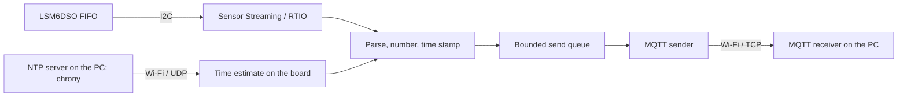

# IMU RAW acquisition and MQTT delivery: design

English | [日本語](imu-raw-mqtt-design-ja.md)

## 1. Purpose and status

Acceleration and angular rate are read from the LSM6DSO of an Arduino Nano RP2040 Connect and
sent to an application on a PC with MQTT. Each axis is sent as the sensor's signed 16-bit raw
integer.

This document describes the design of the implementation (`zephyr/app/usb-console`, and `host/` on the PC) as of 2026-11-12
and what has and has not been verified on hardware. The whole is still experimental: the
payload format and topics are implemented but not final, and are expected to be revised
against the specification of a dedicated PC application. See the [README](../README.md) for
usage.
Section 11 describes the design differences of the port to NuttX 13.1.0 (`nuttx/`).

### Agreed requirements

- Acquire raw data of three axes each for the accelerometer and gyroscope at a configured
  output data rate (ODR) of 6667 Hz.
- Send it to the PC as binary over MQTT. The receiving application on the PC is still to be
  written.
- Keep measuring when Wi-Fi is lost. Data that cannot be sent meanwhile may be discarded.
- Synchronize with the PC's time, aiming at an error within a few milliseconds.

This does not promise freedom from loss in every other situation. FIFO overruns, network
congestion and a receiver that stops are to be detected and reported.

### Implementation status

| Item | Status |
|---|---|
| RAW acquisition, numbering, batching | Implemented |
| MQTT sending (QoS 0), discarding while disconnected, reconnecting | Implemented |
| info / status messages | Implemented (experimental JSON) |
| Recovery after FIFO errors and `epoch_id` | Implemented (verified on hardware with injected overruns only) |
| Sensor time (ticks) on batches | Implemented |
| Synchronization with PC time, PC time on batches | Implemented (NTP, payload version 2) |
| Starting and stopping a measurement | `imu start` / `imu stop` in the shell (no path from the PC yet) |
| Session ID and server address | Implemented (assigned automatically; default gateway by default, changed through the key-value store) |
| Computing a calibration and applying it to `sensor get` / `stream` on the board | Implemented (§10) |
| Receiving and recording application on the PC | Partly implemented (`host/ImuStudio`: receiving, applying the calibration, attitude, spectrum and position display, recording and replay) |
| Operation with a real MQTT broker | Not verified |

### Verified on hardware

Unless noted, the conditions were: accelerometer and gyroscope at 6667 Hz, FIFO watermark 128,
I2C at 1 MHz, timestamp decimation 8, a 2.4 GHz connection to a UGREEN USB adapter acting as
an access point on the PC, and `imu-host check` as the receiver (at the time, the script it was moved from). **Each test was
run once**; none of this is a long-term guarantee.

- 30 minutes continuously: 63128 batches with none missing, PC time on every batch, no time
  going backwards, no FIFO overrun.
- Receiver stopped (6 s), queue full because the receiver stopped reading, access point down
  (about 50 s and about 86 s): acquisition continued in every case, and the board's discard
  counts agreed with the batches missing on the PC.
- Injected FIFO overruns: the stream restarted by itself in a new epoch and the measurement
  continued.
- Time: checked over USB, the board's estimate stayed between -2.3 and +0.6 ms of PC time,
  steadily over 30 minutes. Time did not go backwards after chrony was stopped (about 90 s)
  or after the access point was lost.

The main things not verified are listed in sections 8 and 9. The results for the calibration are
in section 10.6.

### Build and host tests

```sh
cd zephyr
west build -b arduino_nano_connect app/usb-console -d build/usb-console
./script/host_tests.sh
```

There is one configuration, `prj.conf`; RAW streaming and time stamping are always included.
The host tests `fifo_words`, `imu_raw_packet`, `imu_raw_batch`, `imu_raw_queue`,
`imu_raw_status`, `imu_raw_time`, `imu_tick_clock`, `time_offset`, `lsm6dso_cal`, `lsm6dso_zero` and others
cover the
functions described here.

## 2. Overall structure



| Role | Implementation |
|---|---|
| Parsing FIFO words | `drivers/lsm6dso/lsm6dso_fifo.*` |
| Batching, numbering, epochs | `src/imu_raw_batch.*` |
| Building the payload | `src/imu_raw_packet.*` |
| FIFO timestamps to sample ticks | `src/imu_raw_time.*` |
| Ticks to the board clock | `src/imu_tick_clock.*` |
| Board clock to PC time | `src/time_sync.*`, `src/time_offset.*` |
| Send queue | `src/imu_raw_queue.*` |
| MQTT sending, reconnecting, status / info | `src/imu_raw_mqtt.*`, `src/imu_raw_status.*` |
| Acquisition thread, recovery, shell (`imu`) | `src/imu_stream.c` |
| NINA sockets | `drivers/nina/nina_socket.c` (see the [driver README](../zephyr/app/usb-console/drivers/README.md)) |

Reading the FIFO and sending are independent. A lost Wi-Fi or MQTT connection, or a send that
waits, never blocks FIFO reads. Thread priorities are 9 for acquisition (batching) and time
synchronization, 10 for the FIFO read worker and 11 for the MQTT sender. The sender makes the
acquisition side wait only for the queue mutex.

On the PC there is for now `imu-host` in `host/`, which accepts one MQTT client directly. It
is a tool for checking reception (`check`) and for calibration (§10), neither a general broker
nor an always-on receiving and recording application. See [`host/README.md`](../host/README.md)
for usage.

## 3. RAW acquisition

### 3.1 Acquisition and parsing

1. Buffers are obtained per FIFO watermark through Zephyr's `sensor_stream()` and RTIO.
2. `lsm6dso_fifo_buffer_words()` finds the FIFO words in a buffer, and
   `lsm6dso_fifo_next_entry()` interprets them in FIFO order, distinguishing accelerometer and
   gyroscope samples, timestamps and other tags. It also extracts each word's 2-bit tag counter
   and the counter value a timestamp word carries. Only the driver knows the layout of the
   buffer header and of the words; the measurement code uses the results of these two
   functions.
3. Samples are numbered and packed into batches of up to 384 words.
4. A batch is handed to the send queue when it is full or 100 ms after its last sample.

Nothing assumes that accelerometer and gyroscope words alternate in the FIFO; the kind is
carried per word in a bitmap.

### 3.2 Sample numbers, batch numbers and epochs

- Each measurement gets a `session_id`, and the accelerometer numbers, gyroscope numbers and
  batch sequence each start at 0.
- A number is assigned when the sample is taken from the FIFO, whether or not it can be sent.
  Numbers advance through discards caused by a lost connection or a full queue, so the PC can
  tell what is missing from the gaps in what it receives.
- At a discontinuity where **the number of lost samples is unknown**, such as a FIFO overrun,
  `epoch_id` advances by one. Numbers keep counting so that they stay unique in the session,
  but across an epoch boundary consecutive numbers do not mean contiguous samples.

### 3.3 Recovery after FIFO errors

When the driver detects a FIFO overrun, an undersized buffer or an I2C error, it stops the
FIFO and ends the stream with an error. The acquisition thread then sends what it has
collected, advances the epoch and starts the stream again. It gives up and ends the
measurement with the error when

- the sensor's FIFO could not be stopped, or
- three restarts in a row delivered no data.

A packet containing an unexpected tag has its remainder dropped, the epoch advances and the
measurement continues. Recovery was verified by provoking overruns with a test command that
stalled FIFO handling on purpose. That command was removed in the cleanup, so overruns can no
longer be reproduced on the current firmware. I2C faults, the give-up path and unexpected tags
have not been produced on hardware.

## 4. Communication and behaviour when disconnected

### 4.1 Policy

- MQTT 3.1.1; RAW data with QoS 0 and no retain.
- One PUBLISH carries one self-contained batch.
- The send queue has a fixed length of 12 batches (about 0.35 s of data) and never makes FIFO handling wait. When it
  is full, the new batch is discarded and the number of discarded batches and accelerometer
  and gyroscope samples is counted.
- While not connected, the queue content and new batches are discarded. A batch whose send
  failed is not retried.
- After a disconnection the board retries every second. Once reconnected it sends info and
  status again and continues with new batches. The `session_id` does not change and numbers
  keep advancing.

Because of QoS 0, a batch that the board counted as sent may not arrive (data written to a
connection that was about to fail). The disconnection tests showed differences of 1 to 19
batches. The PC detects this from gaps in the sequence, but cannot determine a loss at the
very end unless a later batch arrives.

Right after the access point disappeared, sending blocked for up to about 9 s before the
disconnection was recognized. During that time batches are discarded as "queue full while
connected". Acquisition is not affected.

### 4.2 Server address and behaviour at start

The server is given by the key-value store entries `imu.host` and `imu.port`; the default is
port 1883 on the default gateway. Without `imu.host` the default gateway is looked up again
for every connection attempt, so a measurement can be started before Wi-Fi is connected, and
after moving to another access point the board connects to the PC behind that one.

`imu start` waits up to 3 s for the first connection before acquisition begins. If the
connection is not made in time, acquisition starts alone and batches are discarded and counted
until it is.

### 4.3 States

| State | IMU acquisition | Handling of RAW data |
|---|---|---|
| Not measuring | Stopped | Nothing sent |
| Measuring, MQTT connected | Running | Sent from the queue; new batches discarded and counted when it is full |
| Measuring, not connected | Running | Unsent and new data discarded and counted |
| Reconnected | Running | info / status sent again, new data sent |
| FIFO error | Restarted automatically | Epoch advances (loss of unknown size) |
| Measurement stopped | Stopped | The rest is sent, then a `stopped` status |

## 5. MQTT topics

`<device_id>` consists of letters, digits, `-` and `_` and comes from the key-value store
entry `imu.device` (default `rp2040`).

| Topic | Direction | Payload | QoS / retain | Status |
|---|---|---|---|---|
| `imu/<device_id>/raw` | Board to PC | Binary of section 6 | QoS 0, none | Implemented |
| `imu/<device_id>/info` | Board to PC | JSON with the measurement settings | QoS 1, retained | Implemented |
| `imu/<device_id>/status` | Board to PC | JSON with state and counters | QoS 0, none | Implemented |

### 5.1 info

Sent when a measurement starts, on reconnection and when the stream restarts after a FIFO
error. It uses QoS 1, but is not resent when no PUBACK arrives; it goes out again at the next
reconnection or change.

| Field | Meaning |
|---|---|
| `v` | Version of this JSON (1) |
| `session`, `epoch`, `device` | Session ID (32 hex digits), epoch, device ID |
| `sensor`, `payload`, `payload_version`, `raw`, `axes` | `LSM6DSO`, `IMU1`, `2`, `int16le`, `xyz` |
| `accel_odr_hz`, `gyro_odr_hz` | Configured ODR, not a measured value |
| `accel_ug_per_lsb`, `gyro_udps_per_lsb` | Sensitivity. `app.overlay` sets the ranges to ±8 g and ±2000 dps, which gives 244 and 70000 |
| `fifo_watermark`, `timestamp_decimation` | FIFO settings |
| `time`, `tick_hz_nominal`, `freq_fine` | Kind of tick (`sensor_tick`), nominal 40000 Hz, the sensor's frequency trim |

The tick rate implied by `freq_fine` is only a guide and does not match the measured rate
(section 7.2).

### 5.2 status

Sent on connection and reconnection, when the state changes, and every second. Nothing is kept
for a disconnected period; the cumulative values arrive after reconnection.

| Field | Meaning |
|---|---|
| `state` | `idle` / `measuring` / `stopped` |
| `accel`, `gyro`, `next_batch`, `timestamp_words` | Counts acquired and the next batch number, regardless of sending |
| `fifo_overruns`, `i2c_errors`, `raw_error`, `error` | Errors on the acquisition side |
| `dropped_batches`, `dropped_accel`, `dropped_gyro` | Discarded on the sending side |
| `published`, `connects`, `failures`, `queue_high` | Batches sent (not confirmed delivered), connections, failures, peak queue use |
| `tick`, `tick_mono_us`, `tick_window_us` | A reading of the sensor tick and the board clock taken together (section 7.2) |
| `unix_us`, `unix_estimate_us`, `sync_delay_us` | Estimated PC time for that instant (smoothed and raw) and the NTP round trip behind it |
| `sync` | `ntp` / `unsynchronized` |

## 6. RAW payload (version 2)

### 6.1 Common rules

- Multi-byte integers and raw values are little-endian. Only raw values are signed
  two's-complement `int16`.
- Raw values of each sensor are in the order they were taken from the FIFO.
- One word holds the three axes X, Y, Z in 6 bytes. The kind is in a separate bitmap.
- One PUBLISH contains the header, the bitmap and all raw values. Nothing spans PUBLISH
  boundaries.

### 6.2 Header (96 bytes)

Offsets 0 to 79 are laid out as in version 1; version 2 adds what follows offset 80.

| Offset | Type | Field | Meaning |
|---:|---|---|---|
| 0 | bytes[4] | magic | ASCII `IMU1` |
| 4 | u8 | version | `2` |
| 5 | u8 | flags | See below |
| 6 | u16 | header_len | `96` |
| 8 | bytes[16] | session_id | 128-bit value identifying one measurement |
| 24 | u64 | batch_seq | Batch sequence number, from 0 in a session |
| 32 | u64 | accel_first_index | Number of the first accelerometer sample in this batch |
| 40 | u64 | gyro_first_index | Number of the first gyroscope sample in this batch |
| 48 | u64 | accel_first_tick | Sensor time of the first accelerometer sample (tick extended to 64 bits) |
| 56 | u64 | gyro_first_tick | Sensor time of the first gyroscope sample |
| 64 | u16 | word_count | 1 to 384 |
| 66 | u16 | bitmap_len | `ceil(word_count / 8)` |
| 68 | u32 | epoch_id | Advances by one per loss of unknown size |
| 72 | u32 | time_map_id | Unused (always 0) |
| 76 | u32 | reserved | `0` |
| 80 | u64 | accel_first_unix_us | PC time of the first accelerometer sample (microseconds since 1970) |
| 88 | u64 | gyro_first_unix_us | PC time of the first gyroscope sample |

| flags | Meaning |
|---|---|
| bit 0 | `accel_first_tick` is valid |
| bit 1 | `gyro_first_tick` is valid |
| bit 2 | `accel_first_unix_us` is valid (requires bit 0) |
| bit 3 | `gyro_first_unix_us` is valid (requires bit 1) |
| others | 0 |

For a kind that is absent from the batch, `first_index` is `UINT64_MAX`. An invalid tick or PC
time is 0; validity is decided by the flag, not the value.

### 6.3 Kind bitmap and raw values

In the `bitmap_len` bytes after the header, bit `i % 8` gives the kind of word `i`: `0` for
gyroscope, `1` for accelerometer. Unused high bits of the last byte are 0. The following
`word_count × 6` bytes hold `x, y, z` of each word in order.

A receiver checks the magic, version, lengths, reserved field, flags, unused bitmap bits and
`payload_len == 96 + bitmap_len + 6 × word_count`, and rejects anything out of range or of an
unsupported version instead of misreading it. `host/imu_host/packet.py` does this.

A batch of 384 words has a 48-byte bitmap and 2,304 bytes of raw values, **2,448 bytes** with
the header. With both sensors at 6667 Hz that is about 28.7 ms of data, about 35 batches per
second and about 0.68 Mbit/s of payload.

### 6.4 Using the time on the receiving side

- The time of the first sample in a batch is `*_first_unix_us` as it is, when its flag is set.
- Later samples in a batch are placed by dividing the span to the next batch's first time
  equally by sample number.
- A batch without valid PC time still has ticks, so its time can be filled in from valid
  batches around it or from the readings in status.
- Do not treat the tick length as a constant. The sensor's oscillator was 0.55% off its
  nominal value and also varied by about 70 ppm within 30 minutes.

### 6.5 Session identification

A `session_id` is assigned at every `imu start`. The first 8 bytes are the chip's unique ID,
the next 4 a counter kept in the key-value store (big-endian), and the rest 0. The counter is
stored before the measurement starts, so an ID is never reused across reboots or power loss.
Erasing the key-value store resets the counter to 1.

## 7. Time

### 7.1 Three clocks

1. **Sensor tick**: the timestamp counter inside the LSM6DSO, nominally 25 us.
2. **Board clock**: the RP2040's 1 MHz hardware timer. It is never adjusted.
3. **PC time**: the PC's real time (Unix time), served by chrony.

Zephyr's kernel clock (`k_uptime`, `k_cycle`) is not used as the board clock. It is driven by
SysTick and kept time when idle, but lost about 480 ppm while streaming at 6667 Hz (-59 ms in
122 s). The cause was not investigated. `elapsed_ms` in `imu status` comes from the board
clock, but `kernel uptime` and `uptime_ms` in status are kernel time and can be off by that
much while streaming.

### 7.2 Sensor ticks and the board clock

**Assigning ticks to samples.** The sensor gives all words of one sampling instant the same
2-bit tag counter, which advances by one per instant. A timestamp word describes the samples
that follow it and share its counter. This is the layout observed on hardware with decimation
8; it is also checked at run time and deviations are counted. Samples right after a timestamp
take its value, and later ones advance by the number of ticks per instant measured between the
two most recent timestamps. If that interval is not a whole number of ticks, or the counter
skips, the tick is marked invalid. The 32-bit counter wraps after about 30 hours and is
extended to 64 bits.

A single timestamp cannot be told from a stale or corrupt one. A tick therefore counts as
valid only once the timestamp it rests on has been followed by another at a consistent
distance. This is decided when the batch is sent, so the first sample of a batch normally
still gets a valid tick. A timestamp that goes back without being a wrap is treated as a
restarted counter, and ticks obtained before it are not used.

At 6667 Hz with decimation 8, timestamps were always 48 ticks and 8 samples apart, 6 ticks per
sample.

**Relating ticks to the board clock.** While measuring, the sensor's timestamp register is
read over I2C once per second with the board clock read just before and after (the read takes
0.1 to 0.4 ms). The last 16 such readings are kept; the oldest and newest give the measured
tick rate, with which ticks are converted to the board clock.

- The measured rate was about 40219 ticks per second (24.864 us per tick), 0.55% faster than
  nominal and 0.05% from the value computed from `freq_fine`.
- Until a rate has been measured (about one second into a measurement), the rate of the
  previous measurement is used, or else the one derived from `freq_fine`.
- A conversion that would fall before the previous result is held just after it, so results
  never go backwards.
- A reading is checked against the FIFO's timestamps and not used if it lies before them or
  two seconds or more ahead. A reading that does not continue the earlier ones (a tick length
  outside 23 to 27 us) starts the series over. A tick far from the readings (5 s or more
  ahead, 20 s or more behind) is not converted. This keeps a single bad value from pinning
  all later times through the mechanism that prevents going backwards.

In the first measurement after writing a new image, the first read of the register has
returned a stale value (it did not after a plain reboot; the cause was not investigated). The
check above discards it.

How a tick relates to the instant the sensor actually sampled (the delay inside the sensor)
has not been measured.

### 7.3 The board clock and PC time

The board queries the PC in NTP format. The server is the default gateway (the PC acting as
access point) by default, or a fixed server set with `CONFIG_NINA_NTP_SERVER`. Synchronizing
with a public server was dropped. The PC runs chrony and allows queries from the access
point's subnet (`allow 10.42.0.0/24`, `local stratum 10`).

- A query is sent every 2 s (`CONFIG_NINA_NTP_INTERVAL_MS`) and the reply is polled for at
  1 ms intervals.
- Of the last eight exchanges, the one with the shortest round trip gives the offset. The
  error from an asymmetric path is bounded by half the round trip, so a short one is the more
  certain.
- The drift comes from the change between the best exchanges of successive windows of eight.
- With no reply for 60 s the estimate is invalid. It starts over when Wi-Fi reconnects.

**A clock that never goes back.** The estimate jumps by a few milliseconds, either way,
whenever it switches to another exchange. Times put on batches and used inside the board are
therefore taken from a clock that approaches the estimate at no more than ±500 ppm. It is
continuous and always increasing. Only a difference of half a second or more (the first
estimate, a stepped PC clock) is applied at once. The kernel's realtime clock (`date`) is only
ever moved forward.

**Accuracy verified.** One byte was sent to the board over USB, the board answered
immediately with its estimated time, and the PC's send and receive times bracketed it. In
30712 such probes over 30 minutes none fell outside; at closest the estimate was 0.15 to
0.57 ms after the send time and 1.4 to 2.3 ms before the receive time. If the error was
constant during the test, it lay between -2.3 and +0.6 ms. This is a path other than Wi-Fi,
so the bound includes the bias from an asymmetric Wi-Fi round trip. (The probe command was
removed in the cleanup.)

The NTP round trip while streaming had a median of about 7 ms, and the exchanges used for the
estimate 4 to 6 ms.

**An approach not adopted.** Synchronization requests and replies over MQTT were tried: the
round trip while streaming had a median of about 30 ms with a tail of several hundred, and
checking for input often enough raised the CPU load to 84%.

### 7.4 Without synchronization

Before synchronization, and when NTP has not answered for 60 s or more, the PC time of batches
is invalid (flag clear). Acquisition and ticks continue. When chrony was stopped for about
90 s, about 30 s of batches had invalid time; after it resumed, a correction of up to about
2 ms was approached gradually and time did not go backwards. When the access point was down
for about 86 s, times after reconnection did not fall before those from before the loss, and
the two sides agreed within 1.4 ms.

## 8. Verification

| Item | Status |
|---|---|
| RAW handling and payload format (host tests) | Done |
| Continuous sending (10 min, 30 min) | Done (once each) |
| Receiver stopped, queue full, access point lost | Done (once each) |
| Recovery from FIFO overruns | Done (by injection) |
| I2C faults, the give-up path, unexpected tags | Not done (never produced on hardware) |
| Time: board clock against the PC (USB probe) | Done (between -2.3 and +0.6 ms) |
| Time: delay inside the sensor | Not done (needs a physical reference) |
| Time: loss of synchronization, Wi-Fi reconnection | Done (once each) |
| Settings other than 6667 Hz and decimation 8; different ODRs for the two sensors | Not done |
| Repeated start and stop, resuming after a reboot | Not done |
| A real MQTT broker; operation for hours | Not done |
| Calibration: recovery from synthetic data, cross-check between two hardware recordings | Done (§10.6) |
| Calibration: gyro repeatability, effect of temperature, ranges other than ±8 g and ±2000 dps | Not done |
| Writing a calibration (Telnet, USB), switching on a range change, loading at boot | Done (once each) |
| Gyro bias tracking (replayed recordings, during a measurement, `sensor stream`, `imu cal zero`) | Done (§10.5) |
| Gyro bias tracking: on hardware while moving, rejection of out-of-range readings | Not done (replay and host tests only) |

As a guide to load, `cpu_active` while streaming at 6667 Hz with time stamping was 62 to 66%
(about 72% with the diagnostic USB probe running alongside).

## 9. Open questions

- A path for starting, stopping and configuring a measurement from the PC. For now there are
  only `imu start` and `imu stop` in the shell.
- Whether the PC needs to choose the session ID (the board assigns it now).
- The fields and period of info and status, and the rules for updating the retained info.
  They are experimental JSON for now.
- Whether to use `time_map_id`. PC time is put directly on batches and the field is unused.
- How to treat the delay inside the sensor: take the datasheet value or measure it.
- The recording format of the PC application, and environments that need authentication and
  encryption.
- The gyro bias when the PC applies a calibration to the raw data. The board tracks the value
  at rest for its own output (§10.5) but does not apply it to the raw data.
- Whether the limits for rest (0.3 dps, 2 mg) and the accepted range (1 dps) are right.
- How to treat temperature. The raw data carries none, and a calibration holds for the
  temperature it was taken at.
- Whether the threshold for too little rotation (500 degrees) and the aim (1000) are right.

## 10. Calibration and conversion to physical units

What is sent over MQTT stays raw; no calibration is applied to it. The calibration is computed
on the PC, and is either applied to the raw data there or written to the board, where it applies
to the output of `sensor get` and `sensor stream`. See [`host/README.md`](../host/README.md)
for usage.

### 10.1 Computing the calibration

- The method is the multi-position one (Tedaldi et al.), run with
  [imu_tk](https://bitbucket.org/alberto_pretto/imu_tk/) in Docker. No reference equipment is
  used. Scale, axis misalignment and bias of the accelerometer and of the gyro follow from two
  conditions: the acceleration at rest has the magnitude of gravity, and the rotation between
  two poses equals the integral of the angular rate.
- Recordings are taken at 6667 Hz as in normal use and passed without decimation. imu_tk counts
  "samples taken from each static interval" and "the window of the static detector" in samples,
  so both are set to about one second (6667). The initial gyro scale of the optimizer comes
  from the sensitivity in info. These are build arguments of the image, built from a pinned
  commit of [owhinata/ubuntu-imu_tk](https://github.com/owhinata/ubuntu-imu_tk).
- The input stays in LSB, and sample times are built from the sensor tick. The tick runs about
  0.5% off nominal, which would go straight into the gyro scale, so its rate is measured from
  the points in status (tick against the board clock). NTP synchronization is not needed.
- A recording with gaps, an epoch change or saturation is not used: a gap between two poses
  breaks the integration.
- **The rotation between poses must be spread over all three axes.** Rotation about the axis of
  gravity leaves the accelerometer reading unchanged and carries no information. Each axis's
  rotation is therefore summed weighted by the sine of its angle to gravity and shown, with a
  warning for any axis below 500 degrees (the aim is 1000 or more on each). Both figures are provisional, taken from the recordings at hand.

### 10.2 Conversion on the board

One function converts raw values to physical units, with or without a calibration
(`drivers/lsm6dso/lsm6dso_cal.c`). The FIFO decoder and the one-shot read both use it.

```text
out = M · (raw − bias)
```

| Value | Representation |
|---|---|
| `M` (3×3) | Scale and misalignment combined; int32 with 14 fraction bits on top of the output unit |
| `bias` | int32, in LSB with 8 fraction bits |
| Intermediate sum | int64 |
| `out` | Q31 with shift 9; one unit is 2⁻²² m/s² or rad/s |

No floating point is used; the coefficients are turned into integers on the PC. The rounding
costs at most 0.2% of one LSB, well below the sensor noise (about 5 mg and 1.7 dps RMS at
6667 Hz). Without a calibration the same function runs with the nominal sensitivity on the
diagonal and a zero bias.

### 10.3 Storing and selecting a calibration

Calibrations are kept in the KV store under a key per sensor and sensitivity.

```text
imu.cal.accel.<µg/LSB>      imu.cal.gyro.<µdps/LSB>
```

- The value is 56 bytes: version, kind, sensitivity, nine coefficients, three biases
  (`src/imu_cal.h`).
- The driver does not read the KV store. The application registers a function that looks a
  calibration up by sensitivity, and the driver calls it at registration, on a reload request,
  and whenever a range is set.
- **Without a key for the current sensitivity nothing is applied.** The scale differs between
  ranges from part to part, and a calibration converted from another range would look
  calibrated without its accuracy being known. Calibrating each range and writing it only adds
  keys, and the board then switches with the range.
- The ODR is not part of the key. Calibration is done at 6667 Hz; in one check, the same pose
  read at 104, 833 and 6667 Hz differed by less than 1 mg.
- Each FIFO buffer carries the coefficients in effect when it was read, so the decoder needs
  only the buffer.

### 10.4 How a calibration is written

The existing `kv sethex` is used. The command is the same over Telnet and the USB console, and
`imu-host write` on the PC only switches the path. Nothing was added to the board for writing.

Building a KV image and writing it in BOOTSEL mode was not adopted. The KV store shares its
area with the Wi-Fi settings and other values, which an image would wipe. Splitting the area
needs changes to the storage layer (settings has a single destination) and an NVS image
generator on the PC. Giving the calibration its own format and API was not adopted either,
because it would add something separate to maintain.

### 10.5 Tracking the gyro bias

The gyro bias hardly moves within one measurement, but it does between measurements and
across a power cycle.

| Observation | Change |
|---|---|
| Within a recording of about 6 minutes (means of four parts) | Within 0.25 LSB (0.02 dps) |
| Between two recordings about 40 minutes apart | Up to 1.0 LSB (0.07 dps) |
| Just after a power cycle, against a few hours earlier | Up to 1.0 LSB |
| 104 Hz against 6667 Hz in the same pose | 0.3 to 0.6 LSB |
| Correlation with the direction of gravity | Below 0.1 LSB per g |

The bias of the calibration is therefore not used as a fixed value; it is taken again from
data recorded at rest (`drivers/lsm6dso/lsm6dso_zero.c`). Only `bias` in `M · (raw − bias)` is
replaced; `M` stays the calibration's.

- Samples are grouped into segments of an eighth of a second. Eight consecutive segments that
  agree in mean angular rate (within 0.3 dps) and mean acceleration (within 2 mg) count as
  rest. Single samples are not judged, because at 6667 Hz the noise of one sample (about
  1.7 dps) exceeds any useful limit. What biases the estimate is net rotation within the
  window, and that shows in the segment means.
- The mean of a resting window is blended in: a plain average over the first 20 windows, then
  exponential smoothing with 1/20.
- Rotation about the gravity axis does not change the acceleration, so a slow steady turn
  cannot be told from a bias. Not using a window more than 1 dps from the stored bias (5 dps
  from zero without a calibration) bounds the damage.
- **The sensor is never started automatically.** Tracking runs only while a FIFO stream runs
  (an `imu start` measurement, `sensor stream`). Otherwise `imu cal zero` takes one reading on
  request, running the sensor at 104 Hz for up to three seconds.
- The value is kept in RAM only. A reboot, a reload from the KV store or a range change
  returns to the stored bias.
- It is not applied to the RAW data sent over MQTT. When the PC applies a calibration to the
  raw data, it has to estimate the bias from resting periods itself. `host/ImuStudio` tracks it
  the same way as the board.

Replaying the two recordings at hand (about 6 minutes each) through this code gave no update
while the pose was being changed and resumed updating one to two seconds after the board was
put down. The final value agreed with the mean over the resting periods within 0.3 LSB
(0.02 dps). On hardware the bias was updated every second during a measurement, and
`cpu_active` rose by 0.3 to 0.6 points. `imu cal zero` took about 1.4 seconds, and the result
differed by less than 0.3 LSB between a sensor that had been off and one that was running.

### 10.6 What has been verified, and limits

- Synthetic data with known values (about 4 minutes, 40 poses): the scale was recovered within
  0.03% and the bias within 0.3 LSB.
- Two recordings were taken on hardware. The calibration from the one with rotation about all
  three axes reduced the error on the other one as well (acceleration error at rest 0.8 mg RMS;
  error predicting the direction of gravity between poses 0.20 degrees, against 0.29 with the
  nominal sensitivity). The calibration from the one with lopsided rotation had one gyro scale
  7.9% off nominal and did worse than the nominal sensitivity on the other recording
  (2.25 degrees).
- The accelerometer values agreed between the two (scale within 0.06%, bias within 0.3 LSB).
  For the gyro there is only one recording with all three axes covered, so repeatability is
  unverified.
- The board's output matched the PC applying the calibration to the board's uncalibrated output
  in the same pose, within 0.2 mg and 7×10⁻⁵ rad/s.
- **A calibration describes the sensor as it was when calibrated.** About two and a half hours
  later, after a power cycle, the acceleration at rest was 2 to 3 mg below gravity and a gyro
  bias of about 0.1 dps remained. The gyro bias is taken again by the tracking of §10.5; there
  is nothing comparable for the accelerometer. The raw data carries no temperature and no temperature
  compensation is done.

## 11. The NuttX port

`nuttx/` holds a port of the same firmware to NuttX 13.1.0 (the NuttX port). The design of
sections 1 to 10 (acquisition, numbering, payload, topics, behaviour when disconnected, time
stamping, calibration) is the same; this section describes only the design differences that come
from the different OS. Usage, the command map, the error number map and the detailed list of
differences are in [`nuttx/README.md`](../nuttx/README.md), the drivers in
[`nuttx/drivers/README.md`](../nuttx/drivers/README.md). The results in section 8 are the Zephyr
version's; what has been verified on the NuttX port is listed separately in 11.7.

### 11.1 Approach

- The OS-independent sources (batches, payload, queue, status, time mapping, NTP estimate, FIFO
  parser, calibration format) are copied unchanged from the Zephyr version, and the same host
  tests also run on the NuttX side.
- The sources that call the OS (`imu_stream.c`, `imu_raw_mqtt.c`, `time_sync.c`, `imu_cal.c`,
  `wifi_profile.c`, `nina_net.c`, the LSM6DSO driver with its FIFO stream, the sensor shell) are
  also copied almost as they are, on top of a compatibility layer (`nuttx/drivers/compat/`) that
  provides the OS calls **under Zephyr's names**. The layer has only what the copied sources use
  (`struct device`, the sensor API, RTIO, work queues, parts of `k_sem`, `k_mutex` and `k_poll`,
  `net_mgmt` events, `zsock_*()`, shell command tables). The constants, branches, order, waits,
  counters and output strings are those of the Zephyr sources.
- Thread priorities map as `NuttX = 118 − Zephyr`. What corresponds to Zephyr's cooperative
  threads becomes an ordinary thread at 119 (NuttX has no cooperative threads).
- The project's own commands (`imu`, `kv`, `ntp`, `nina`, `dmesg`, `i2c_dma`, `sensor`,
  `wifi cred`) keep the Zephyr version's syntax and output; the standard Zephyr commands are left
  to standard NuttX ones (`wapi`, `ifconfig`, `iperf`, `ps`, `reboot`, `i2c`, `date`). Every
  command the PC tools send is of the first kind, so the tools only have to know the USB console
  name and the prompt, which are in `host/firmware_profiles.toml`.
- Error numbers are shown with NuttX's values (not converted to the Zephyr version's), the
  `raw_error` and `error` of the MQTT status included. The map is in `nuttx/README.md`.

### 11.2 Sockets (usrsock)

The NINA-W102's sockets are provided through NuttX's usrsock (`CONFIG_NET_USRSOCK_CUSTOM`).
`usrsock_request()` in the kernel handles each request synchronously **in the context of the
calling thread**, serialized by the mutex of the NINA transfer layer, as the Zephyr version runs
the SPI at the caller's priority and serializes with `nina_lock`. The lock order is fixed as
"usrsock lock, then the NINA mutex".

- usrsock learns from driver events that a socket can receive, can send or was closed. The NINA
  does not signal these with an interrupt, so the thread `nina_event` asks the NINA and turns the
  answers into events (the 1 ms retry of a waiting send, the check that a connect has finished,
  and polling of plain POSIX sockets such as Telnet's and `iperf`'s every 20 ms).
- Sockets made with the compatibility layer's `zsock_socket()` (MQTT, NTP) are marked so that only
  the caller polls them on the NINA, and `nina_event` leaves them out of its 20 ms polling.
  `zsock_poll()` and `zsock_recv()` poll the NINA in the calling thread, as the Zephyr driver does.
  The commands that reach the NINA are in the Zephyr version's order.
- To get the Zephyr version's "a waiting TCP send gives `EAGAIN` after 10 s" and "a datagram the
  NINA did not take gives `EAGAIN` at once", a small patch is applied to NuttX's usrsock
  (`nuttx/patches/nuttx/0005`).
- The NINA is also registered as the NuttX network device `wlan0`, and the requests of `wapi` and
  `ifconfig` are turned into operations of the driver (a copy of the Zephyr version's
  `nina_net.c`).

### 11.3 Clocks and tick

- The "board clock" of 7.1 is the RP2040 TIMER (1 MHz from the crystal) in both, read the same way.
- The Zephyr version's kernel clock is SysTick from the CPU clock and falls behind while sending
  (7.1). For the NuttX port, a 100 µs tickless kernel clock on the TIMER's ALARM0 was implemented on
  the board side (NuttX's RP2040 port has no tickless support). In the NuttX port the kernel clock
  (`k_uptime_get()`, `uptime_ms` of the status, `clock_gettime()`), `k_cycle_get_*()`, the sensor
  clock and the time base of the CPU load therefore all come from the TIMER. Waits are rounded up
  to a tick plus one tick, as in the Zephyr version.
- Both versions use `time_sync_mono_us()`, which reads the TIMER directly, as the time reference
  (section 7).

### 11.4 Measuring the CPU load

`cpu_active` of `imu status` has the meaning of the Zephyr version's `CONFIG_CPU_LOAD` (the idle
hook back end). The Zephyr version closes the idle window at interrupt entry, so the time spent in
interrupts taken while idle counts as load. The NuttX port has its own idle loop: with interrupts
disabled it reads the TIMER, waits in `WFI`, reads the TIMER again and adds the interval to the idle
time, and only then enables interrupts (the handler runs after that and counts as load).
`cpu_active` does not use NuttX's own `CONFIG_SCHED_CPULOAD` (sampling at each tick means something
else, and accounting at switches gives per-thread shares with interrupt time in the interrupted
thread).

The per-thread share is shown in the CPU column of `ps` (NuttX's own
`CONFIG_SCHED_CPULOAD_CRITMONITOR`, timed by the TIMER). Like the Zephyr version's
`CONFIG_SCHED_THREAD_USAGE` (`kernel ps`, `kernel thread list`) it accounts at switches and puts
interrupt time in the interrupted thread. The `ps` value is a moving average (halved about once a
second), the Zephyr version's is accumulated since boot. The share over an interval comes from the
difference of the total run time in `/proc/<tid>/critmon` ("CPU load" in `nuttx/README.md`).

### 11.5 KV format and moving the values

- The KV store is in the same place as in the Zephyr version, the last 8 KiB of flash (two 4 KiB
  erase units), with the same key and value rules, API and commands, but the format is NuttX's
  NVS (`/dev/config`, names `app_kv/<key>`, Wi-Fi credentials `wifi_cred/<number>`), not
  compatible with the Zephyr version's (settings on NVS).
- If the area is neither in this format nor erased, the NuttX port erases it at its first boot.
- `script/kv_transfer.py` moves the values: `backup` while the Zephyr version runs (reads with
  `kv get` and saves on the PC), then flash the NuttX port, then `restore` (writes with
  `kv sethex` and reads back; `imu cal reload` after the calibration). Wi-Fi credentials cannot be
  taken from flash, so `restore` asks for the password and registers it with `wifi cred add`. The
  session counter (`imu.session`) is not written back; the NuttX port starts at 1.
- Going back from the NuttX port to the Zephyr version does not keep the values either, for the
  same reason.

### 11.6 Fatal errors and the log

- On an exception, `PANIC()`, a failed assertion or the stack sentinel, the NuttX port writes a
  report to the RAM log and restarts by itself (`CONFIG_BOARD_RESET_ON_ASSERT=2`). The Zephyr
  version is now configured to reboot after a fatal error as well (`CONFIG_RESET_ON_FATAL_ERROR=y`; checked
  once by reading an unmapped address with the shell's `devmem`: the HardFault report stayed in the RAM log
  and the board rebooted).
- The RAM log has the Zephyr version's format and the same `dmesg`, but is 8 KiB so that the
  report of a fatal error fits (the Zephyr version's is 4 KiB). A log line is formatted in the
  calling thread (the Zephyr version's default is deferred).

### 11.7 What has and has not been verified on the NuttX port

Verified on the board (the conditions and values are kept in the records, not in this document):

- The shell on the USB console and over Telnet, the flashing script, `reboot`.
- KV reads and writes, keeping the values over a restart, the capacity limit, and moving the
  values (KV and Wi-Fi credentials) from the Zephyr version.
- NINA transfers, sockets (TCP and UDP, the time limit of a waiting send, failed connects), and
  Wi-Fi: connecting, reconnecting by itself, coming back after a scan, and not reconnecting after a
  manual disconnect.
- I2C0 with DMA reads, the LSM6DSOX initialization and FIFO stream.
- Acquisition at 6667 Hz and MQTT delivery (with `imu-host check`: the first measurement after
  flashing, 10 minutes in a row, the receiver dropping the connection and stalling, the board's
  Wi-Fi disconnected, Telnet connections and disconnections while sending): missing batches, valid
  and backward times, `errors` and `fifo` of `imu status`.
- NTP synchronization, the synchronization becoming invalid after a Wi-Fi disconnection and coming
  back after reconnecting, and the real-time clock only moving forward.
- Loading the calibration, every subcommand of `imu cal`, the switch on a range change, every
  subcommand of `sensor` and its exclusion with a measurement.
- The automatic restart and the report after a fatal error.
- `record`, `check` and `write` of `imu-host` (USB and Telnet), and `calib` reading a recording made
  with the NuttX port.

Not verified:

- Comparison with the Zephyr version under the same conditions (CPU load, NTP round trip, high-ODR
  `sensor stream`).
- Paths not triggered on the board, such as the automatic restart after a FIFO error, CQE overflow,
  and a KV garbage collection during a measurement.
- Power loss (KV robustness, the RAM log being cleared), unplugging USB, the RESET button, suspending
  the PC.
- Detecting a disconnection when the AP side stops, a real MQTT broker, running for several hours.
- How the Zephyr version behaves when written after the NuttX port.
- Operation from the ImuStudio GUI (its shell part is covered by tests).

## References

- [Zephyr Read and Decode](https://docs.zephyrproject.org/latest/hardware/peripherals/sensor/read_and_decode.html)
- [ST LSM6DSO datasheet](https://www.st.com/resource/en/datasheet/lsm6dso.pdf)
- [ST LSM6DSO application note AN5192](https://www.st.com/resource/en/application_note/an5192-lsm6dso-alwayson-3d-accelerometer-and-3d-gyroscope-stmicroelectronics.pdf)
- [OASIS MQTT 3.1.1](https://docs.oasis-open.org/mqtt/mqtt/v3.1.1/os/mqtt-v3.1.1-os.html)
- [chrony](https://chrony-project.org/documentation.html)
- D. Tedaldi, A. Pretto, E. Menegatti, "A Robust and Easy to Implement Method for IMU Calibration
  without External Equipments", ICRA 2014 (the method of imu_tk)
