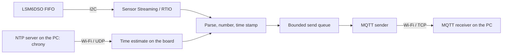
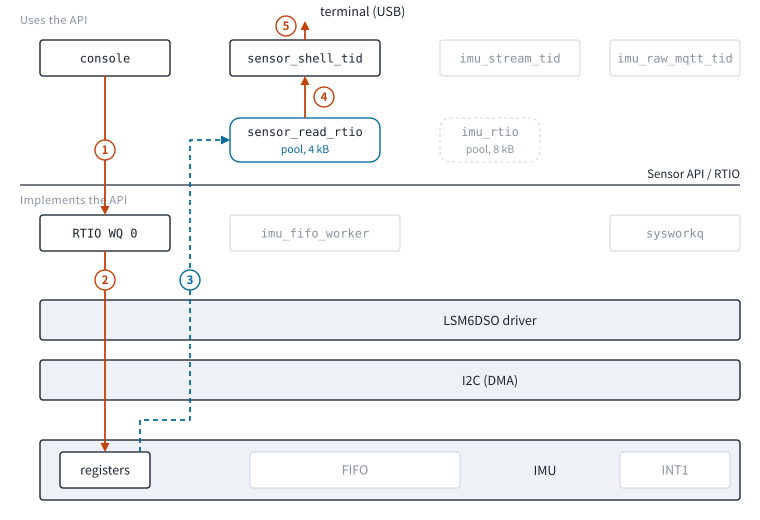
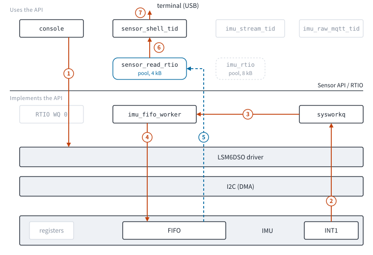
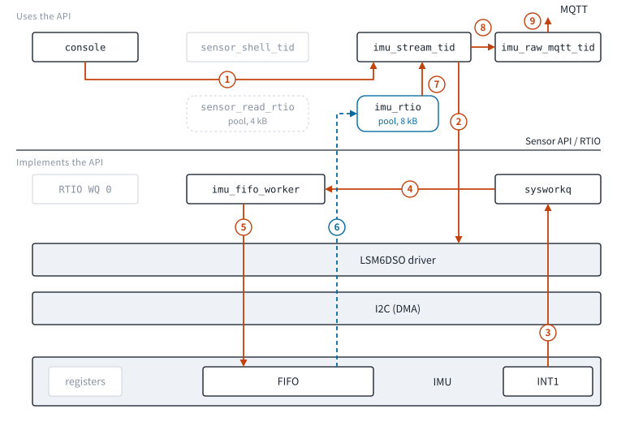

# IMU RAW acquisition and MQTT delivery: design

English | [日本語](imu-raw-mqtt-design-ja.md)

## 1. Purpose and status

Acceleration and angular rate are read from the LSM6DSO of an Arduino Nano RP2040 Connect and
sent to an application on a PC with MQTT. Each axis is sent as the sensor's signed 16-bit raw
integer.

This document describes the design of the implementation (`zephyr/app/usb-console`, and `host/` on the PC)
and what has and has not been verified on hardware. The whole is still experimental: the
payload format and topics are implemented but not final, and are expected to be revised
against the specification of a dedicated PC application. See the [README](../README.md) for
usage.
The firmware is also built on NuttX 13.1.0 (`nuttx/`), on the Pico SDK and FreeRTOS (`freertos/`) and on the
Pico SDK and ThreadX (`threadx/`): the Zephyr, NuttX, FreeRTOS and ThreadX builds.
Section 9 describes the layout of the sources the four builds share (`common/`) and the design differences
that come from the different OSes.

### Agreed requirements

- Acquire raw data of three axes each for the accelerometer and gyroscope at a configured
  output data rate (ODR) of 6667 Hz.
- Send it to the PC as binary over MQTT. The receiving application on the PC is still to be
  written.
- Keep measuring when Wi-Fi is lost. Data that cannot be sent meanwhile may be discarded.
- Synchronize with the PC's time, aiming at an error within a few milliseconds.

This does not promise freedom from loss in every other situation. FIFO overruns, network
congestion and a receiver that stops are to be detected and reported.

### Implementation status

| Item | Status |
|---|---|
| RAW acquisition, numbering, batching | Implemented |
| MQTT sending (QoS 0), discarding while disconnected, reconnecting | Implemented |
| info / status messages | Implemented (experimental JSON) |
| Recovery after FIFO errors and `epoch_id` | Implemented (verified on hardware with injected overruns only) |
| Sensor time (ticks) on batches | Implemented |
| Synchronization with PC time, PC time on batches | Implemented (NTP, payload version 2) |
| Starting and stopping a measurement | `imu start` / `imu stop` in the shell (no path from the PC yet) |
| Session ID and server address | Implemented (assigned automatically; default gateway by default, changed through the key-value store) |
| Computing a calibration and applying it to `sensor get` / `stream` on the board | Implemented (§8) |
| Receiving and recording application on the PC | Partly implemented (`host/ImuStudio`: receiving, applying the calibration, attitude, spectrum and position display, recording and replay) |
| Operation with a real MQTT broker | Not verified |

### Verified on hardware

Unless noted, the conditions were: accelerometer and gyroscope at 6667 Hz, FIFO watermark 128,
I2C at 1 MHz, timestamp decimation 8, a 2.4 GHz connection to a UGREEN USB adapter acting as
an access point on the PC, and `imu-host check` as the receiver (at the time, the script it was moved from). **Each test was
run once**; none of this is a long-term guarantee.

I2C0 has this setting from the start, for the FIFO streams (`imu start`, `sensor stream`) and for single reads
and writes alike (100 kHz cannot empty the FIFO from 833 Hz up).
"I2C at 1 MHz" is the speed class asked for (Fast-mode Plus); the real SCL is faster than 1 MHz. With the
DesignWare driver's counts and the 125 MHz clock, SCL is high for 39 clocks (312 ns) and low for 32
(256 ns), and a recorded read of 3584 bytes in 22.9 ms puts it at about 1.4 MHz (the waveform was not
measured). That is outside the LSM6DSOX's specification (1 MHz at most, SCL low for 0.50 µs and high for
0.26 µs at least): the low time is too short and the frequency too high. The FIFO data at 6667 Hz needs
about 890,000 clocks a second, about 89% of the bus even at the specification's 1 MHz, which leaves
about 11% for the register addresses and the gaps between transfers. With counts inside the
specification (504 ns low, 360 ns high; a read of the full FIFO, 3584 bytes, then takes 32.1 ms, about
1.0 MHz) the FreeRTOS build's FIFO overran 136 to 137 times in a stream of about 70 seconds (three
runs).

The table gives the Zephyr build's results. What has been verified on the other builds follows the table,
build by build.

| Item | Status |
|---|---|
| RAW handling and payload format (host tests) | Done |
| Continuous sending (10 min, 30 min) | Done (once each; in 30 minutes 63128 batches with none missing, PC time on every batch, no time going backwards, no FIFO overrun) |
| Receiver stopped (6 s), queue full because the receiver stopped reading, access point down (about 50 s and about 86 s) | Done (once each; acquisition continued in every case, and the board's discard counts agreed with the batches missing on the PC) |
| Recovery from FIFO overruns | Done (by injection; the stream restarted by itself in a new epoch and the measurement continued) |
| I2C faults, the give-up path, unexpected tags | Not done (never produced on hardware) |
| Time: board clock against the PC (USB probe) | Done (between -2.3 and +0.6 ms, steadily over 30 minutes; section 7.3) |
| Time: delay inside the sensor | Not done (needs a physical reference) |
| Time: loss of synchronization, Wi-Fi reconnection | Done (once each; time did not go backwards after chrony was stopped (about 90 s) or after the access point was lost; section 7.4) |
| Settings other than 6667 Hz and decimation 8; different ODRs for the two sensors | Not done |
| Repeated start and stop, resuming after a reboot | Not done |
| A real MQTT broker; operation for hours | Not done |
| Calibration: recovery from synthetic data, cross-check between two hardware recordings | Done (§8.6) |
| Calibration: gyro repeatability, effect of temperature, ranges other than ±8 g and ±2000 dps | Not done |
| Writing a calibration (Telnet, USB), switching on a range change, loading at boot | Done (once each) |
| Gyro bias tracking (replayed recordings, during a measurement, `sensor stream`, `imu cal zero`) | Done (§8.5) |
| Gyro bias tracking: on hardware while moving, rejection of out-of-range readings | Not done (replay and host tests only) |

As a guide to load, `cpu_active` while streaming at 6667 Hz with time stamping is as follows (the guide of
2026-11-24). It moves by 1 to 2 points with the layout of the image even when nothing else changes.

| Zephyr build | NuttX build | FreeRTOS build | ThreadX build |
|---|---|---|---|
| about 21.4% | about 23.5 to 24.7% | about 19.3 to 19.7% | about 18.4% |

The NINA's SPI moves the transfers of 64 bytes or more by DMA while the calling thread waits, and polls the
shorter ones (the driver notes of each build). In a run with every payload byte set to a known value and checked on
the PC, 18 to 20 million bytes per build arrived with none wrong (the Zephyr, NuttX and FreeRTOS builds). Running the
busy code from RAM is described in "Code in RAM" in section 9.1.

#### The Zephyr build

Most of the hardware checks in the table above were made with images from before the NINA driver moved onto the
shared core. With the images that use it, the first measurement after flashing, Telnet and `wifi scan` while
sending, a manual disconnection and its recovery, Telnet after repeated `zperf` downloads, connecting by itself
with the key-value store and credentials another build wrote, the USB and Telnet shells after repeated
`zperf tcp download stop` during a connection, reading the NINA's flash through the passthrough and `bootsel`
were checked. Recovery from losing the access point, a congested receiver and long runs have not been checked
with the images that use it (in any of the Zephyr, NuttX and FreeRTOS builds). The restart after a fatal error is
in section 9.2.5.

#### The NuttX build

Verified on the board (the conditions and values are kept in the records, not in this document):

- The shell on the USB console and over Telnet, the flashing script, `reboot`.
- KV reads and writes, keeping the values over a restart, the capacity limit, and moving the
  values (KV and Wi-Fi credentials) from the Zephyr version.
- NINA transfers, sockets (TCP and UDP, the time limit of a waiting send, failed connects), and
  Wi-Fi: connecting, reconnecting by itself, coming back after a scan, and not reconnecting after a
  manual disconnect.
- I2C0 with DMA reads, the LSM6DSOX initialization and FIFO stream.
- Acquisition at 6667 Hz and MQTT delivery (with `imu-host check`: the first measurement after
  flashing, 10 minutes in a row, the receiver dropping the connection and stalling, the board's
  Wi-Fi disconnected, Telnet connections and disconnections while sending): missing batches, valid
  and backward times, `errors` and `fifo` of `imu status`.
- NTP synchronization, the synchronization becoming invalid after a Wi-Fi disconnection and coming
  back after reconnecting, and the real-time clock only moving forward.
- Loading the calibration, every subcommand of `imu cal`, the switch on a range change, every
  subcommand of `sensor` and its exclusion with a measurement.
- The automatic restart and the report after a fatal error.
- `record`, `check` and `write` of `imu-host` (USB and Telnet), and `calib` reading a recording made
  with the NuttX port.
- Comparison with the Zephyr and FreeRTOS builds on the same day with the same steps: CPU load while
  sending and TCP rates (2026-11-18; the values are in the README).
- The Zephyr version, written after the NuttX port, using the key-value store and the stored Wi-Fi
  credentials as they are (2026-11-18).
- The final image (2026-11-18: the divider, the ROM's `memcpy` and `memset`, support for the new firmware,
  `bootsel`, `nina passthrough`): the first measurement after flashing, the capability bits of
  `nina version`, `iperf`, reading the NINA's flash through the passthrough, `bootsel` (Telnet with the
  image before). Saving the divider was checked with test images (`nuttx/drivers/README.md`).

Not verified:

- Comparison with the Zephyr version with the current images of the NTP round trip and high-ODR
  `sensor stream`.
- Paths not triggered on the board, such as the automatic restart after a FIFO error, CQE overflow,
  and a KV garbage collection during a measurement.
- Power loss (KV robustness, the RAM log being cleared), unplugging USB, the RESET button, suspending
  the PC.
- Detecting a disconnection when the AP side stops, a congested receiver, a real MQTT broker, running for
  several hours (with the final image, a manual disconnection and its recovery and a stopped receiver too).
- Operation from the ImuStudio GUI (its shell part is covered by tests).

#### The FreeRTOS build

Verified on the board (2026-11-17, once each):

- The shell on USB and over Telnet, `flash.sh` (sending `bootsel` by itself), `reboot`, the automatic
  restart and the record after a fatal error.
- KV reads and writes, keeping the values over a restart, garbage collection (erases), reading the KV and
  the Wi-Fi credentials the NuttX build wrote.
- NINA transfers, I2C0 with DMA reads, the LSM6DSOX initialization and FIFO stream.
- Wi-Fi: connecting with the stored credentials by itself, coming back after a scan, not reconnecting after
  a manual disconnect, disconnecting and reconnecting during a measurement.
- Telnet with one client and the second refused, reconnecting at short intervals, `zperf` upload and
  download.
- NTP synchronization, the queries stopping on a Wi-Fi disconnection and the synchronization coming back
  after reconnecting.
- Acquisition at 6667 Hz and MQTT delivery (with `imu-host check`: the first measurement after flashing,
  the receiver dropping the connection and stalling, the board's Wi-Fi disconnected, Telnet connections
  and disconnections while sending, repeated starts and stops): missing batches, valid and backward times,
  `errors` and `fifo` of `imu status`. A KV garbage collection during a measurement (one FIFO overrun with
  an automatic restart, as in the NuttX build).
- Loading the calibration, every subcommand of `imu cal`, the switch on a range change, `get`, `attr_set`
  and `stream` of `sensor` and their exclusion with a measurement.

Checked with the final default image (`-Os`, 1 ms tick, waiting for READY on the interrupt; 2026-11-18, once
each): the first measurement after flashing, at rest, `zperf` upload and download, `zperf` and Telnet together
while sending, the layer's kernel test on the board (22 items, the tick's catch-up included; the `selftest` command of that image's `-DSELFTEST=ON` build), the comparison with the Zephyr and NuttX
builds on the same day with the same steps of the CPU load while sending and the TCP rates (the values are in
the README), support for the new firmware with 0001 to 0006 (the capability bits, `wifi scan` while connected
keeping the connection, a manual disconnection and its recovery), reading and writing the NINA's flash through
the passthrough, and `bootsel`. The other items above,
such as the receiver dropping the connection and stalling and a Wi-Fi disconnection during a measurement,
were checked with the image of 2026-11-17 (`-O3`, 100 µs tick, READY polled) and not with the final image.

Not verified:

- Measurements of tens of minutes or more, congestion longer than 10 s, detecting a disconnection when
  the AP side stops (with the final image, a stopped receiver too).
- The tick after a `kv set` during a measurement.
- The time becoming invalid after a long disconnection, an NTP server given by name.
- `kv wipe confirm`, the NuttX build reading what the FreeRTOS build stored (the Zephyr build read it on
  2026-11-18).
- A fatal error during a flash erase, a NINA that does not answer.
- `record` and `write` of `imu-host` and `script/kv_transfer.py` (with the USB detection) against the
  FreeRTOS build.
- Power loss, unplugging USB, the RESET button.
- With the code in RAM ("Code in RAM" in section 9.1): only `cpu_active` and the XIP cache's misses while sending
  (no missing batches) have been measured.

#### The ThreadX build

Verified on the board (2026-11-24, once each; the records are in `threadx/PORTING_STATUS.md`):

- On the host: the compatibility layer's kernel test (22 items) and the waits of the I2C and NINA drivers, on
  ThreadX's Linux port (`threadx/script/host_tests.sh`).
- The test firmware on the board (`threadx/tests/board_kernel`): the layer's kernel test (22 items, with the
  wake-up from an interrupt, the tick's catch-up and the real time that the host skips), a wake-up inside the
  lock and nesting, an alarm interrupt inside the lock, the idle windows and run times, and the interop with the
  Pico SDK's locks.
- From the first start after flashing: USB enumeration and the prompt, `version`, `ps`, `uptime`, `free`, `fault`,
  `dmesg` (no `<err>`), `i2c read_byte`, `sensor get`, reading the key-value store another build wrote, connecting
  to Wi-Fi by itself, `nina version`, `ntp status` synchronized.
- Acquisition at 6667 Hz and MQTT delivery (with `imu-host check`, the first measurement after flashing,
  60 seconds): no missing batch, no time going backwards, `published` = `batches`.
- Sending for 30 minutes: 62,843 batches with none missing, no time going backwards, no overrun, no warning or
  error in `dmesg`, and the tick agreeing with the TIMER after about 3103 seconds (with a build that had the
  kernel's busy parts in RAM; the present configuration keeps the kernel in the flash).
- Telnet connections while sending (3 times), `wifi scan` while sending, `wifi disconnect` and reconnecting with
  `wifi cred auto_connect` with the sending coming back, Telnet after the reconnection (in that run 371 batches
  discarded on the board, 372 missing on the receiver, no time going backwards, no overrun).
- `sensor stream` right after a restart (watermark 32; 104, 833, 3333 and 6667 Hz, 30 seconds each): none of the
  four stopped.
- A key-value write, keeping it over a restart, deleting it. The restart after `devmem 30000000`, and the
  HardFault, the thread's name, pc, lr and sp in `fault`.
- The passthrough (`nina passthrough confirm`): `esptool` read the NINA's 2 MB flash at 115200 and 921600 bps;
  the two reads agreed with each other and with the saved image.
- `zperf tcp upload` (3.62 Mbps, no errors) and `zperf tcp download` from `iperf3 -c` (2.52 Mbps).
- `i2c scan`.

Not verified:

- Detecting a stack overflow (there is no way to provoke one), `-DI2C_DW_I2C1=ON` on the board, entering the
  passthrough after the entry `main()` moved to the OS's directory.
- A stopped and a stalled receiver, detecting a disconnection when the AP side stops, a congested receiver.
- `kv wipe confirm`, and `record` and `write` of `imu-host` and `script/kv_transfer.py` against the ThreadX build.
- Power loss, unplugging USB, the RESET button.

The open questions are in section 10, the results for the calibration in section 8.6.

### Build and host tests

The commands for building, flashing and the host tests are in each build's README.

| OS | Usage | Host tests |
|---|---|---|
| Zephyr | [README](../README.md) | `zephyr/script/host_tests.sh` |
| NuttX | [`nuttx/README.md`](../nuttx/README.md) | `nuttx/script/host_tests.sh` |
| FreeRTOS | [`freertos/README.md`](../freertos/README.md) | `freertos/script/host_tests.sh` |
| ThreadX | [`threadx/README.md`](../threadx/README.md) | `threadx/script/host_tests.sh` |

Each build has one configuration (the Zephyr build's is `prj.conf`); RAW streaming and time stamping are always
included. The `host_tests.sh` of every build first runs the host tests of the shared sources (`common/tests/run.sh`),
whose `fifo_words`, `imu_raw_packet`, `imu_raw_batch`, `imu_raw_queue`,
`imu_raw_status`, `imu_raw_time`, `imu_tick_clock`, `time_offset`, `lsm6dso_cal`, `lsm6dso_zero` and others
cover the
functions described here.

## 2. Overall structure



| Role | Implementation |
|---|---|
| Parsing FIFO words | `common/drivers/lsm6dso/lsm6dso_fifo.c` (declared in `include/lsm6dso_fifo.h`, read through `<zephyr/drivers/sensor/lsm6dso.h>`) |
| Batching, numbering, epochs | `common/imu/imu_raw_batch.*` |
| Building the payload | `common/imu/imu_raw_packet.*` |
| FIFO timestamps to sample ticks | `common/imu/imu_raw_time.*` |
| Ticks to the board clock | `common/imu/imu_tick_clock.*` |
| Board clock to PC time | `common/imu/time_sync.*`, `common/imu/time_offset.*` |
| Send queue | `common/imu/imu_raw_queue.*` |
| MQTT sending, reconnecting, status / info | `common/imu/imu_raw_mqtt.*`, `common/imu/imu_raw_status.*` |
| Acquisition thread, recovery, shell (`imu`) | `common/imu/imu_stream.c` |
| NINA sockets | `common/drivers/nina/port/zephyr/nina_socket.c`, `common/drivers/nina/nina_sock.*` (see the [driver README](../zephyr/app/usb-console/drivers/README.md)) |

`src/` and `drivers/` are under `zephyr/app/usb-console`; `common/` is under the repository's root and
holds the parts whose files are the same as the NuttX, FreeRTOS and ThreadX builds' (section 9.1).

Reading the FIFO and sending are independent. A lost Wi-Fi or MQTT connection, or a send that
waits, never blocks FIFO reads. Thread priorities are 9 for acquisition (batching) and time
synchronization, 10 for the FIFO read worker and 11 for the MQTT sender. The sender makes the
acquisition side wait only for the queue mutex.

On the PC there is for now `imu-host` in `host/`, which accepts one MQTT client directly. It
is a tool for checking reception (`check`) and for calibration (§8), neither a general broker
nor an always-on receiving and recording application. See [`host/README.md`](../host/README.md)
for usage.

## 3. RAW acquisition

### 3.1 Acquisition and parsing

1. Buffers are obtained per FIFO watermark through Zephyr's `sensor_stream()` and RTIO.
2. `lsm6dso_fifo_buffer_words()` finds the FIFO words in a buffer, and
   `lsm6dso_fifo_next_entry()` interprets them in FIFO order, distinguishing accelerometer and
   gyroscope samples, timestamps and other tags. It also extracts each word's 2-bit tag counter
   and the counter value a timestamp word carries. Only the driver knows the layout of the
   buffer header and of the words; the measurement code uses the results of these two
   functions.
3. Samples are numbered and packed into batches of up to 384 words.
4. A batch is handed to the send queue when it is full or 100 ms after its last sample.

Nothing assumes that accelerometer and gyroscope words alternate in the FIFO; the kind is
carried per word in a bitmap.

### 3.2 Sample numbers, batch numbers and epochs

- Each measurement gets a `session_id`, and the accelerometer numbers, gyroscope numbers and
  batch sequence each start at 0.
- A number is assigned when the sample is taken from the FIFO, whether or not it can be sent.
  Numbers advance through discards caused by a lost connection or a full queue, so the PC can
  tell what is missing from the gaps in what it receives.
- At a discontinuity where **the number of lost samples is unknown**, such as a FIFO overrun,
  `epoch_id` advances by one. Numbers keep counting so that they stay unique in the session,
  but across an epoch boundary consecutive numbers do not mean contiguous samples.

### 3.3 Recovery after FIFO errors

When the driver detects a FIFO overrun, an undersized buffer or an I2C error, it stops the
FIFO and ends the stream with an error. The acquisition thread then sends what it has
collected, advances the epoch and starts the stream again. It gives up and ends the
measurement with the error when

- the sensor's FIFO could not be stopped, or
- three restarts in a row delivered no data.

A packet containing an unexpected tag has its remainder dropped, the epoch advances and the
measurement continues. Recovery was verified by provoking overruns with a test command that
stalled FIFO handling on purpose. The present firmware does not have that command, so overruns cannot
be reproduced on it. I2C faults, the give-up path and unexpected tags
have not been produced on hardware.

### 3.4 The three paths that read the sensor

Three paths read the sensor: `sensor get`, `sensor stream` and `imu start`. All of them go through Zephyr's sensor
API and RTIO and share the driver below (`common/drivers/lsm6dso`) and I2C. What differs is the threads and the
buffers on the side that uses the API.

The three figures have the same layout. The horizontal line is the boundary of the sensor API and RTIO: above it is
the side that uses the API, below it the side that implements it. Each figure draws in full only the boxes and lines
its path uses. Solid orange lines are requests and notifications, dashed blue lines the flow of the data, and the
numbers are the steps under the figure.

**`sensor get` (one read)**



1. `console` requests one read (`sensor_read_async_mempool()`).
2. `RTIO WQ 0` reads the registers through the driver and I2C.
3. The values go into a buffer taken from the shell's pool (`sensor_read_rtio`).
4. The notification of the completed read wakes `sensor_shell_tid`.
5. `sensor_shell_tid` converts to physical values and writes to the terminal itself; `console` is not on this path.

**`sensor stream` (reads the FIFO continuously and prints)**



1. `console` requests continuous reads (`sensor_stream()`). The driver keeps the request, and the command returns.
2. When the FIFO reaches its watermark, the INT1 interrupt comes. Its handler only submits a work item to `sysworkq`.
3. `sysworkq` passes the read on as a work item of `imu_fifo_worker`.
4. `imu_fifo_worker` reads the FIFO over I2C (DMA).
5. The data goes straight into a buffer taken from the shell's pool.
6. The notification of the completed read wakes `sensor_shell_tid`.
7. `sensor_shell_tid` converts and writes the average of that read to the terminal itself.

Steps 2 to 7 repeat.

**`imu start` (reads the FIFO continuously and sends by MQTT)**



1. `console` notifies `imu_stream_tid` of the start (`k_sem_give(&start_request)`).
2. `imu_stream_tid` requests continuous reads (`sensor_stream()`).
3. When the FIFO reaches its watermark, the INT1 interrupt comes and submits a work item to `sysworkq`.
4. `sysworkq` passes the read on as a work item of `imu_fifo_worker`.
5. `imu_fifo_worker` reads the FIFO over I2C (DMA).
6. The data goes straight into a buffer taken from the measurement's pool (`imu_rtio`).
7. The notification of the completed read wakes `imu_stream_tid`, which builds batches of the raw values and gives
   them their times.
8. A batch goes into the send queue (8 batches).
9. `imu_raw_mqtt_tid` takes it from the queue and sends it by MQTT.

Steps 3 to 9 repeat.

| | `sensor get` | `sensor stream` | `imu start` |
|---|---|---|---|
| Thread that requests | `console` | `console` | `imu_stream_tid` |
| Thread that reads the sensor | `RTIO WQ 0` | `sysworkq` → `imu_fifo_worker` | the same |
| What is read | registers | the FIFO | the same |
| Buffer | the shell's pool, 4 kB (64 blocks of 64 bytes) | the same | the measurement's pool, 8 kB (128 blocks of 64 bytes) |
| Thread that is notified | `sensor_shell_tid` | `sensor_shell_tid` | `imu_stream_tid` |
| What it does then | converts and prints | converts and prints the average | builds batches, sent by MQTT |

- The pools belong to the side that uses the API. The driver has no buffer of its own: for every read it takes one
  from the user's pool, fills it and gives it back.
- A read takes as large a buffer as the pool has, up to the whole FIFO (512 words, about 3.6 kB). The shell's pool
  holds one read. The thread that is notified (`sensor_shell_tid` at priority 0, `imu_stream_tid` at 9) has a higher
  priority than `imu_fifo_worker` (10), so it finishes and returns the buffer before the next read starts.
- The chip has one FIFO, so `sensor stream` and `imu start` cannot run together: the one started first has it, and
  the other is refused.

## 4. Communication and behaviour when disconnected

### 4.1 Policy

- MQTT 3.1.1; RAW data with QoS 0 and no retain.
- One PUBLISH carries one self-contained batch.
- The send queue has a fixed length of 8 batches (about 0.23 s of data) and never makes FIFO handling wait. When it
  is full, the new batch is discarded and the number of discarded batches and accelerometer
  and gyroscope samples is counted.
- While not connected, the queue content and new batches are discarded. A batch whose send
  failed is not retried.
- After a disconnection the board retries every second. Once reconnected it sends info and
  status again and continues with new batches. The `session_id` does not change and numbers
  keep advancing.

Because of QoS 0, a batch that the board counted as sent may not arrive (data written to a
connection that was about to fail). The disconnection tests showed differences of 1 to 19
batches. The PC detects this from gaps in the sequence, but cannot determine a loss at the
very end unless a later batch arrives.

Right after the access point disappeared, sending blocked for up to about 9 s before the
disconnection was recognized. During that time batches are discarded as "queue full while
connected". Acquisition is not affected.

### 4.2 Server address and behaviour at start

The server is given by the key-value store entries `imu.host` and `imu.port`; the default is
port 1883 on the default gateway. Without `imu.host` the default gateway is looked up again
for every connection attempt, so a measurement can be started before Wi-Fi is connected, and
after moving to another access point the board connects to the PC behind that one.

`imu start` waits up to 3 s for the first connection before acquisition begins. If the
connection is not made in time, acquisition starts alone and batches are discarded and counted
until it is.

### 4.3 States

| State | IMU acquisition | Handling of RAW data |
|---|---|---|
| Not measuring | Stopped | Nothing sent |
| Measuring, MQTT connected | Running | Sent from the queue; new batches discarded and counted when it is full |
| Measuring, not connected | Running | Unsent and new data discarded and counted |
| Reconnected | Running | info / status sent again, new data sent |
| FIFO error | Restarted automatically | Epoch advances (loss of unknown size) |
| Measurement stopped | Stopped | The rest is sent, then a `stopped` status |

## 5. MQTT topics

`<device_id>` consists of letters, digits, `-` and `_` and comes from the key-value store
entry `imu.device` (default `rp2040`).

| Topic | Direction | Payload | QoS / retain | Status |
|---|---|---|---|---|
| `imu/<device_id>/raw` | Board to PC | Binary of section 6 | QoS 0, none | Implemented |
| `imu/<device_id>/info` | Board to PC | JSON with the measurement settings | QoS 1, retained | Implemented |
| `imu/<device_id>/status` | Board to PC | JSON with state and counters | QoS 0, none | Implemented |

### 5.1 info

Sent when a measurement starts, on reconnection and when the stream restarts after a FIFO
error. It uses QoS 1, but is not resent when no PUBACK arrives; it goes out again at the next
reconnection or change.

| Field | Meaning |
|---|---|
| `v` | Version of this JSON (1) |
| `session`, `epoch`, `device` | Session ID (32 hex digits), epoch, device ID |
| `sensor`, `payload`, `payload_version`, `raw`, `axes` | `LSM6DSO`, `IMU1`, `2`, `int16le`, `xyz` |
| `accel_odr_hz`, `gyro_odr_hz` | Configured ODR, not a measured value |
| `accel_ug_per_lsb`, `gyro_udps_per_lsb` | Sensitivity. `app.overlay` sets the ranges to ±8 g and ±2000 dps, which gives 244 and 70000 |
| `fifo_watermark`, `timestamp_decimation` | FIFO settings |
| `time`, `tick_hz_nominal`, `freq_fine` | Kind of tick (`sensor_tick`), nominal 40000 Hz, the sensor's frequency trim |

The tick rate implied by `freq_fine` is only a guide and does not match the measured rate
(section 7.2).

### 5.2 status

Sent on connection and reconnection, when the state changes, and every second. Nothing is kept
for a disconnected period; the cumulative values arrive after reconnection.

| Field | Meaning |
|---|---|
| `state` | `idle` / `measuring` / `stopped` |
| `accel`, `gyro`, `next_batch`, `timestamp_words` | Counts acquired and the next batch number, regardless of sending |
| `fifo_overruns`, `i2c_errors`, `raw_error`, `error` | Errors on the acquisition side |
| `dropped_batches`, `dropped_accel`, `dropped_gyro` | Discarded on the sending side |
| `published`, `connects`, `failures`, `queue_high` | Batches sent (not confirmed delivered), connections, failures, peak queue use |
| `tick`, `tick_mono_us`, `tick_window_us` | A reading of the sensor tick and the board clock taken together (section 7.2) |
| `unix_us`, `unix_estimate_us`, `sync_delay_us` | Estimated PC time for that instant (smoothed and raw) and the NTP round trip behind it |
| `sync` | `ntp` / `unsynchronized` |

## 6. RAW payload (version 2)

### 6.1 Common rules

- Multi-byte integers and raw values are little-endian. Only raw values are signed
  two's-complement `int16`.
- Raw values of each sensor are in the order they were taken from the FIFO.
- One word holds the three axes X, Y, Z in 6 bytes. The kind is in a separate bitmap.
- One PUBLISH contains the header, the bitmap and all raw values. Nothing spans PUBLISH
  boundaries.

### 6.2 Header (96 bytes)

Offsets 0 to 79 are laid out as in version 1; version 2 adds what follows offset 80.

| Offset | Type | Field | Meaning |
|---:|---|---|---|
| 0 | bytes[4] | magic | ASCII `IMU1` |
| 4 | u8 | version | `2` |
| 5 | u8 | flags | See below |
| 6 | u16 | header_len | `96` |
| 8 | bytes[16] | session_id | 128-bit value identifying one measurement |
| 24 | u64 | batch_seq | Batch sequence number, from 0 in a session |
| 32 | u64 | accel_first_index | Number of the first accelerometer sample in this batch |
| 40 | u64 | gyro_first_index | Number of the first gyroscope sample in this batch |
| 48 | u64 | accel_first_tick | Sensor time of the first accelerometer sample (tick extended to 64 bits) |
| 56 | u64 | gyro_first_tick | Sensor time of the first gyroscope sample |
| 64 | u16 | word_count | 1 to 384 |
| 66 | u16 | bitmap_len | `ceil(word_count / 8)` |
| 68 | u32 | epoch_id | Advances by one per loss of unknown size |
| 72 | u32 | time_map_id | Unused (always 0) |
| 76 | u32 | reserved | `0` |
| 80 | u64 | accel_first_unix_us | PC time of the first accelerometer sample (microseconds since 1970) |
| 88 | u64 | gyro_first_unix_us | PC time of the first gyroscope sample |

| flags | Meaning |
|---|---|
| bit 0 | `accel_first_tick` is valid |
| bit 1 | `gyro_first_tick` is valid |
| bit 2 | `accel_first_unix_us` is valid (requires bit 0) |
| bit 3 | `gyro_first_unix_us` is valid (requires bit 1) |
| others | 0 |

For a kind that is absent from the batch, `first_index` is `UINT64_MAX`. An invalid tick or PC
time is 0; validity is decided by the flag, not the value.

### 6.3 Kind bitmap and raw values

In the `bitmap_len` bytes after the header, bit `i % 8` gives the kind of word `i`: `0` for
gyroscope, `1` for accelerometer. Unused high bits of the last byte are 0. The following
`word_count × 6` bytes hold `x, y, z` of each word in order.

A receiver checks the magic, version, lengths, reserved field, flags, unused bitmap bits and
`payload_len == 96 + bitmap_len + 6 × word_count`, and rejects anything out of range or of an
unsupported version instead of misreading it. `host/imu_host/packet.py` does this.

A batch of 384 words has a 48-byte bitmap and 2,304 bytes of raw values, **2,448 bytes** with
the header. With both sensors at 6667 Hz that is about 28.7 ms of data, about 35 batches per
second and about 0.68 Mbit/s of payload.

### 6.4 Using the time on the receiving side

- The time of the first sample in a batch is `*_first_unix_us` as it is, when its flag is set.
- Later samples in a batch are placed by dividing the span to the next batch's first time
  equally by sample number.
- A batch without valid PC time still has ticks, so its time can be filled in from valid
  batches around it or from the readings in status.
- Do not treat the tick length as a constant. The sensor's oscillator was 0.55% off its
  nominal value and also varied by about 70 ppm within 30 minutes.

### 6.5 Session identification

A `session_id` is assigned at every `imu start`. The first 8 bytes are the chip's unique ID,
the next 4 a counter kept in the key-value store (big-endian), and the rest 0. The counter is
stored before the measurement starts, so an ID is never reused across reboots or power loss.
Erasing the key-value store resets the counter to 1.

## 7. Time

### 7.1 Three clocks

1. **Sensor tick**: the timestamp counter inside the LSM6DSO, nominally 25 us.
2. **Board clock**: the RP2040's 1 MHz hardware timer. It is never adjusted.
3. **PC time**: the PC's real time (Unix time), served by chrony.

Zephyr's kernel clock (`k_uptime`, `k_cycle`) is not used as the board clock. It is driven by
SysTick and kept time when idle, but lost about 480 ppm while streaming at 6667 Hz (-59 ms in
122 s). The cause was not investigated. `elapsed_ms` in `imu status` comes from the board
clock, but `kernel uptime` and `uptime_ms` in status are kernel time and can be off by that
much while streaming.

### 7.2 Sensor ticks and the board clock

**Assigning ticks to samples.** The sensor gives all words of one sampling instant the same
2-bit tag counter, which advances by one per instant. A timestamp word describes the samples
that follow it and share its counter. This is the layout observed on hardware with decimation
8; it is also checked at run time and deviations are counted. Samples right after a timestamp
take its value, and later ones advance by the number of ticks per instant measured between the
two most recent timestamps. If that interval is not a whole number of ticks, or the counter
skips, the tick is marked invalid. The 32-bit counter wraps after about 30 hours and is
extended to 64 bits.

A single timestamp cannot be told from a stale or corrupt one. A tick therefore counts as
valid only once the timestamp it rests on has been followed by another at a consistent
distance. This is decided when the batch is sent, so the first sample of a batch normally
still gets a valid tick. A timestamp that goes back without being a wrap is treated as a
restarted counter, and ticks obtained before it are not used.

At 6667 Hz with decimation 8, timestamps were always 48 ticks and 8 samples apart, 6 ticks per
sample.

**Relating ticks to the board clock.** While measuring, the sensor's timestamp register is
read over I2C once per second with the board clock read just before and after (the read takes
0.1 to 0.4 ms). The last 16 such readings are kept; the oldest and newest give the measured
tick rate, with which ticks are converted to the board clock.

- The measured rate was about 40219 ticks per second (24.864 us per tick), 0.55% faster than
  nominal and 0.05% from the value computed from `freq_fine`.
- Until a rate has been measured (about one second into a measurement), the rate of the
  previous measurement is used, or else the one derived from `freq_fine`.
- A conversion that would fall before the previous result is held just after it, so results
  never go backwards.
- A reading is checked against the FIFO's timestamps and not used if it lies before them or
  two seconds or more ahead. A reading that does not continue the earlier ones (a tick length
  outside 23 to 27 us) starts the series over. A tick far from the readings (5 s or more
  ahead, 20 s or more behind) is not converted. This keeps a single bad value from pinning
  all later times through the mechanism that prevents going backwards.

In the first measurement after writing a new image, the first read of the register has
returned a stale value (it did not after a plain reboot; the cause was not investigated). The
check above discards it.

How a tick relates to the instant the sensor actually sampled (the delay inside the sensor)
has not been measured.

### 7.3 The board clock and PC time

The board queries the PC in NTP format. The server is the default gateway (the PC acting as
access point) by default, or a fixed server set with `CONFIG_NINA_NTP_SERVER`. The PC runs chrony and allows queries from the access
point's subnet (`allow 10.42.0.0/24`, `local stratum 10`).

- A query is sent every 2 s (`CONFIG_NINA_NTP_INTERVAL_MS`) and the reply is polled for at
  1 ms intervals.
- Of the last eight exchanges, the one with the shortest round trip gives the offset. The
  error from an asymmetric path is bounded by half the round trip, so a short one is the more
  certain.
- The drift comes from the change between the best exchanges of successive windows of eight.
- With no reply for 60 s the estimate is invalid. It starts over when Wi-Fi reconnects.

**A clock that never goes back.** The estimate jumps by a few milliseconds, either way,
whenever it switches to another exchange. Times put on batches and used inside the board are
therefore taken from a clock that approaches the estimate at no more than ±500 ppm. It is
continuous and always increasing. Only a difference of half a second or more (the first
estimate, a stepped PC clock) is applied at once. The kernel's realtime clock (`date`) is only
ever moved forward.

**Accuracy verified.** One byte was sent to the board over USB, the board answered
immediately with its estimated time, and the PC's send and receive times bracketed it. In
30712 such probes over 30 minutes none fell outside; at closest the estimate was 0.15 to
0.57 ms after the send time and 1.4 to 2.3 ms before the receive time. If the error was
constant during the test, it lay between -2.3 and +0.6 ms. This is a path other than Wi-Fi,
so the bound includes the bias from an asymmetric Wi-Fi round trip. (The present firmware does not
have the probe command.)

The NTP round trip while streaming had a median of about 7 ms, and the exchanges used for the
estimate 4 to 6 ms.

**An approach not adopted.** Synchronization requests and replies over MQTT were tried: the
round trip while streaming had a median of about 30 ms with a tail of several hundred, and
checking for input often enough raised the CPU load to 84%.

### 7.4 Without synchronization

Before synchronization, and when NTP has not answered for 60 s or more, the PC time of batches
is invalid (flag clear). Acquisition and ticks continue. When chrony was stopped for about
90 s, about 30 s of batches had invalid time; after it resumed, a correction of up to about
2 ms was approached gradually and time did not go backwards. When the access point was down
for about 86 s, times after reconnection did not fall before those from before the loss, and
the two sides agreed within 1.4 ms.

## 8. Calibration and conversion to physical units

What is sent over MQTT stays raw; no calibration is applied to it. The calibration is computed
on the PC, and is either applied to the raw data there or written to the board, where it applies
to the output of `sensor get` and `sensor stream`. See [`host/README.md`](../host/README.md)
for usage.

### 8.1 Computing the calibration

- The method is the multi-position one (Tedaldi et al.), run with
  [imu_tk](https://bitbucket.org/alberto_pretto/imu_tk/) in Docker. No reference equipment is
  used. Scale, axis misalignment and bias of the accelerometer and of the gyro follow from two
  conditions: the acceleration at rest has the magnitude of gravity, and the rotation between
  two poses equals the integral of the angular rate.
- Recordings are taken at 6667 Hz as in normal use and passed without decimation. imu_tk counts
  "samples taken from each static interval" and "the window of the static detector" in samples,
  so both are set to about one second (6667). The initial gyro scale of the optimizer comes
  from the sensitivity in info. These are build arguments of the image, built from a pinned
  commit of [owhinata/ubuntu-imu_tk](https://github.com/owhinata/ubuntu-imu_tk).
- The input stays in LSB, and sample times are built from the sensor tick. The tick runs about
  0.5% off nominal, which would go straight into the gyro scale, so its rate is measured from
  the points in status (tick against the board clock). NTP synchronization is not needed.
- A recording with gaps, an epoch change or saturation is not used: a gap between two poses
  breaks the integration.
- **The rotation between poses must be spread over all three axes.** Rotation about the axis of
  gravity leaves the accelerometer reading unchanged and carries no information. Each axis's
  rotation is therefore summed weighted by the sine of its angle to gravity and shown, with a
  warning for any axis below 500 degrees (the aim is 1000 or more on each). Both figures are provisional, taken from the recordings at hand.

### 8.2 Conversion on the board

One function converts raw values to physical units, with or without a calibration
(`common/drivers/lsm6dso/lsm6dso_cal.c`). The FIFO decoder and the one-shot read both use it.

```text
out = M · (raw − bias)
```

| Value | Representation |
|---|---|
| `M` (3×3) | Scale and misalignment combined; int32 with 14 fraction bits on top of the output unit |
| `bias` | int32, in LSB with 8 fraction bits |
| Intermediate sum | int64 |
| `out` | Q31 with shift 9; one unit is 2⁻²² m/s² or rad/s |

No floating point is used; the coefficients are turned into integers on the PC. The rounding
costs at most 0.2% of one LSB, well below the sensor noise (about 5 mg and 1.7 dps RMS at
6667 Hz). Without a calibration the same function runs with the nominal sensitivity on the
diagonal and a zero bias.

### 8.3 Storing and selecting a calibration

Calibrations are kept in the KV store under a key per sensor and sensitivity.

```text
imu.cal.accel.<µg/LSB>      imu.cal.gyro.<µdps/LSB>
```

- The value is 56 bytes: version, kind, sensitivity, nine coefficients, three biases
  (`common/imu/imu_cal.h`).
- The driver does not read the KV store. The application registers a function that looks a
  calibration up by sensitivity, and the driver calls it at registration, on a reload request,
  and whenever a range is set.
- **Without a key for the current sensitivity nothing is applied.** The scale differs between
  ranges from part to part, and a calibration converted from another range would look
  calibrated without its accuracy being known. Calibrating each range and writing it only adds
  keys, and the board then switches with the range.
- The ODR is not part of the key. Calibration is done at 6667 Hz; in one check, the same pose
  read at 104, 833 and 6667 Hz differed by less than 1 mg.
- Each FIFO buffer carries the coefficients in effect when it was read, so the decoder needs
  only the buffer.

### 8.4 How a calibration is written

The existing `kv sethex` is used. The command is the same over Telnet and the USB console, and
`imu-host write` on the PC only switches the path. Nothing was added to the board for writing.

Building a KV image and writing it in BOOTSEL mode was not adopted. The KV store shares its
area with the Wi-Fi settings and other values, which an image would wipe. Splitting the area
needs changes to the storage layer (settings has a single destination) and an NVS image
generator on the PC. Giving the calibration its own format and API was not adopted either,
because it would add something separate to maintain.

### 8.5 Tracking the gyro bias

The gyro bias hardly moves within one measurement, but it does between measurements and
across a power cycle.

| Observation | Change |
|---|---|
| Within a recording of about 6 minutes (means of four parts) | Within 0.25 LSB (0.02 dps) |
| Between two recordings about 40 minutes apart | Up to 1.0 LSB (0.07 dps) |
| Just after a power cycle, against a few hours earlier | Up to 1.0 LSB |
| 104 Hz against 6667 Hz in the same pose | 0.3 to 0.6 LSB |
| Correlation with the direction of gravity | Below 0.1 LSB per g |

The bias of the calibration is therefore not used as a fixed value; it is taken again from
data recorded at rest (the `lsm6dso_zero_*()` functions of `common/drivers/lsm6dso/lsm6dso_cal.c`). Only `bias` in `M · (raw − bias)` is
replaced; `M` stays the calibration's.

- Samples are grouped into segments of an eighth of a second. Eight consecutive segments that
  agree in mean angular rate (within 0.3 dps) and mean acceleration (within 2 mg) count as
  rest. Single samples are not judged, because at 6667 Hz the noise of one sample (about
  1.7 dps) exceeds any useful limit. What biases the estimate is net rotation within the
  window, and that shows in the segment means.
- The mean of a resting window is blended in: a plain average over the first 20 windows, then
  exponential smoothing with 1/20.
- Rotation about the gravity axis does not change the acceleration, so a slow steady turn
  cannot be told from a bias. Not using a window more than 1 dps from the stored bias (5 dps
  from zero without a calibration) bounds the damage.
- **The sensor is never started automatically.** Tracking runs only while a FIFO stream runs
  (an `imu start` measurement, `sensor stream`). Otherwise `imu cal zero` takes one reading on
  request, running the sensor at 104 Hz for up to three seconds.
- The value is kept in RAM only. A reboot, a reload from the KV store or a range change
  returns to the stored bias.
- It is not applied to the RAW data sent over MQTT. When the PC applies a calibration to the
  raw data, it has to estimate the bias from resting periods itself. `host/ImuStudio` tracks it
  the same way as the board.

Replaying the two recordings at hand (about 6 minutes each) through this code gave no update
while the pose was being changed and resumed updating one to two seconds after the board was
put down. The final value agreed with the mean over the resting periods within 0.3 LSB
(0.02 dps). On hardware the bias was updated every second during a measurement, and
`cpu_active` rose by 0.3 to 0.6 points. `imu cal zero` took about 1.4 seconds, and the result
differed by less than 0.3 LSB between a sensor that had been off and one that was running.

### 8.6 What has been verified, and limits

- Synthetic data with known values (about 4 minutes, 40 poses): the scale was recovered within
  0.03% and the bias within 0.3 LSB.
- Two recordings were taken on hardware. The calibration from the one with rotation about all
  three axes reduced the error on the other one as well (acceleration error at rest 0.8 mg RMS;
  error predicting the direction of gravity between poses 0.20 degrees, against 0.29 with the
  nominal sensitivity). The calibration from the one with lopsided rotation had one gyro scale
  7.9% off nominal and did worse than the nominal sensitivity on the other recording
  (2.25 degrees).
- The accelerometer values agreed between the two (scale within 0.06%, bias within 0.3 LSB).
  For the gyro there is only one recording with all three axes covered, so repeatability is
  unverified.
- The board's output matched the PC applying the calibration to the board's uncalibrated output
  in the same pose, within 0.2 mg and 7×10⁻⁵ rad/s.
- **A calibration describes the sensor as it was when calibrated.** About two and a half hours
  later, after a power cycle, the acceleration at rest was 2 to 3 mg below gravity and a gyro
  bias of about 0.1 dps remained. The gyro bias is taken again by the tracking of §8.5; there
  is nothing comparable for the accelerometer. The raw data carries no temperature and no temperature
  compensation is done.

## 9. Shared sources and each OS

The design of sections 1 to 8 (acquisition, numbering, payload, topics, behaviour when disconnected, time
stamping, calibration) is the same in the four builds. This section describes the layout of the shared sources
(`common/`, section 9.1) and the design differences that come from the different OSes (sections 9.2 to 9.5). The list
of what each build writes (the boundary with the OS) is in [`design/os-boundary.md`](os-boundary.md). What has been
verified on each build is collected in "Verified on hardware" in section 1.

### 9.1 Shared sources (`common/`)

The four builds share the OS-independent code and the drivers and services written on Zephyr's API as
single files in the repository's `common/`. The Zephyr build compiles them on Zephyr itself; the NuttX,
FreeRTOS and ThreadX builds compile them on a compatibility layer that provides Zephyr's API under Zephyr's names. The
host tests (`common/tests/run.sh`) run first in the `host_tests.sh` of each of the four builds.

| Place | Contents | Builds |
|---|---|---|
| `common/imu/` | The acquisition service and `imu`, batches, payload, queue, status, time assignment and time synchronization with `ntp`, calibration and `imu cal`, the MQTT transport, the Wi-Fi profile and automatic reconnection, the key-value API and `kv`; the null implementations of the transport and of the time synchronization (`imu_raw_mqtt_null.c`, `time_sync_null.c`) | All four (the MQTT client `mqtt_min*` NuttX, FreeRTOS and ThreadX; the Zephyr build uses Zephyr's MQTT library; the null implementations only a build without the module) |
| `common/drivers/lsm6dso/` | The LSM6DSO driver: its core with no OS at the top (`lsm6dso.c`, `lsm6dso_stream.c`, `lsm6dso_cal.c`, `lsm6dso_fifo.c`; headers in `include/` and `internal/`, the boundaries `lsm6dso_os.h` and `lsm6dso_stream_req.h` in `port/`), its Zephyr binding with the FIFO stream's RTIO side in `port/zephyr/` (a Zephyr module for the Zephyr build; its extended API `<zephyr/drivers/sensor/lsm6dso.h>` is `include/lsm6dso.h`), the NuttX build's device in `port/nuttx/` and the device of the builds on the Pico SDK (FreeRTOS, ThreadX) in `port/pico_sdk/` | All four |
| `common/shell/sensor_shell.c` | The sensor shell, the file of the Zephyr build's patched tree (patch 0006, below), but each build's `sensor_shell_os.h` | All four |
| `common/drivers/nina/` | The NINA core (SPI link, sockets, name resolution, the Wi-Fi operations `nina_wifi.[ch]`, the socket waits `nina_wait.[ch]`, the declarations `nina_proto.h`), the esptool passthrough `nina_passthrough.[ch]` with its boundaries `nina_passthrough_bus.h` and `nina_passthrough_os.h`, with no OS of its own | All four |
| `common/drivers/nina/port/zephyr/`, `nuttx/`, `pico_sdk/`, `freertos/`, `threadx/` | The core's bindings to Zephyr's APIs (Wi-Fi management and interface, kernel services, socket offload, the devicetree binding and options), to NuttX's (`wlan0` and wapi, the applications' Zephyr Wi-Fi management, kernel services, usrsock), to the Pico SDK (SPI, DMA, lines, the passthrough's module side) and to FreeRTOS and ThreadX (kernel services `nina_os.c`: locks, requests, sleeps, the clock, the waits on READY's and the IRQ line's edge interrupts; the wait for the DMA's completion `nina_bus_dma_os_impl.h`); in `zephyr/`, `nuttx/` and `pico_sdk/`, the passthrough's host side `nina_passthrough_os.c` (Zephyr's CDC ACM, cdcacm, TinyUSB) | `zephyr/`: Zephyr, FreeRTOS and ThreadX (their Wi-Fi and socket bindings, on the compatibility layer); `nuttx/`: NuttX; `pico_sdk/`: FreeRTOS and ThreadX; `freertos/`: FreeRTOS; `threadx/`: ThreadX |
| `common/drivers/i2c_dw/` | The I2C core (I2C0 and I2C1; file names as Zephyr's: `i2c_dw.c` at the top and, in `internal/`, `i2c_dw.h`, `i2c_dw_registers.h`, `i2c_dw_rp2040.h`, `i2c_dw_rp2040_dma_priv.h` with the DMA reads and their command words), the declarations of the `i2c_dma` functions in `include/i2c_dw_rp2040_dma.h`, the boundaries `i2c_dw_os.h` and `i2c_dw_dma_os.h` in `port/`, and the bindings in `port/nuttx/`, `port/pico_sdk/`, `port/freertos/` and `port/threadx/` | NuttX, FreeRTOS and ThreadX (the Zephyr build: the same driver in patch 0003, below) |
| `common/drivers/stmemsc/` | The glue between ST's driver and Zephyr's I2C API | NuttX, FreeRTOS and ThreadX |
| `common/compat/` | The OS-independent part of the compatibility layer and copies of Zephyr's libraries (the key-value store's NVS and settings, the Wi-Fi credentials, getopt and others) | NuttX, FreeRTOS and ThreadX |
| `common/shell/`, `common/compat/log/` | Zephyr's shell command handling, the `i2c_dma` and `nina` commands, the `LOG_*` macros and the RAM log's ring | NuttX, FreeRTOS and ThreadX (`i2c_dma` all four, `nina` Zephyr, FreeRTOS and ThreadX) |
| `common/chip/rp2040/` | The RP2040's code that no OS owns (the TIMER's read, the watchdog's restart, the key-value area's flash boundary) | All four (the flash boundary NuttX, FreeRTOS and ThreadX) |
| `common/imu/port/pico_sdk/` | The application's part on the Pico SDK (the shared steps of the start, `version`, `free`, the idle windows, fatal errors, the build) | FreeRTOS and ThreadX |

Each module of `common/` has the same layout: the headers other modules read in `include/`, its own in
`internal/`, the boundary headers an OS implements in `port/`, an OS's implementation in `port/<os>/`, the
implementation shared by the builds on the Pico SDK in `port/pico_sdk/` and the one for an OS without its
own in `port/generic/` (`design/os-boundary.md`). The OS parts are implementations of narrow boundary
headers, in the modules' `port/<os>/` and in each build's directory.

- The kernel part of the compatibility layer (`k_mutex`, `k_sem`, threads, clocks and so on; listed at the
  top of `common/compat/include/zephyr/kernel.h`): `common/compat/port/nuttx/`, `common/compat/port/freertos/`, `common/compat/port/threadx/`.
- The priority mapping `priorities_os.h` (read by `common/compat/include/priorities.h`), the NINA's `nina_os.h` and
  `nina_bus.h` (`nina_os.h`'s implementations are in the core's bindings,
  `common/drivers/nina/port/zephyr/`, `nuttx/`, `freertos/` and `threadx/`), the I2C core's `i2c_dw_os.h` and the DMA reads' `i2c_dw_dma_os.h` (implemented in the core's bindings,
  `common/drivers/i2c_dw/port/nuttx/`, `pico_sdk/`, `freertos/` and `threadx/`), the key-value flash's `flash_kv_os.h`, the shell backend
  `zshell_os.h`, the log's `app_log_os.h`, `log_ram.h` and `log_ram_os.h`.
- A few lines that differ per build: `sensor_shell_os.h` (the wait of `sensor get`), `wifi_profile_os.h`,
  `lsm6dso_instance.h` (the device, which `lsm6dso_sensor.c` includes at its end: the Zephyr build's devicetree
  instance macros, one device with the board's values on NuttX), `kv_store_os.h` (whether there is `kv wipe`).

#### The compatibility layer

In the NuttX, FreeRTOS and ThreadX builds the shared sources run on top of a compatibility layer
(its OS-independent part in `common/compat/`, each OS's implementation in
`common/compat/port/<os>/`) that provides the OS calls **under Zephyr's names**. The layer has only what the copied sources use
(`struct device`, the sensor API, RTIO, work queues, parts of `k_sem`, `k_mutex` and `k_poll`,
`net_mgmt` events, `zsock_*()`, shell command tables). The constants, branches, order, waits,
counters and output strings are those of the Zephyr sources. Of the sources that
call the OS, `imu_stream.c`, `time_sync.c`, `imu_raw_mqtt.c`, `imu_cal.c`, `wifi_profile.c`,
the LSM6DSO driver's Zephyr binding (`port/zephyr/`: `lsm6dso_sensor.[ch]`, `lsm6dso_rtio.c` and the stream's RTIO side) and the sensor shell's
`sensor_shell.c`, with the header `kv_store.h`, are also the single files in `common/` that the
builds use (their command registration is the Zephyr build's text too).

#### The LSM6DSO driver and the sensor shell

**The LSM6DSO driver (`common/drivers/lsm6dso/`)** is used by the Zephyr build as NINA's is, from `common/`: its
Zephyr binding `port/zephyr/` is a Zephyr module (`zephyr/module.yml`, in the application's `ZEPHYR_EXTRA_MODULES`)
whose option `CONFIG_LSM6DSO_LOCAL` takes the place of Zephyr's own driver of the same devicetree nodes
(`CONFIG_LSM6DSO=n` in `prj.conf`), whose library holds the core and the binding, and which exports
`<zephyr/drivers/sensor/lsm6dso.h>`. The NuttX, FreeRTOS and ThreadX builds compile the same core and binding on the
compatibility layer, which also provides `<zephyr/drivers/sensor/lsm6dso.h>` (`common/compat/include/zephyr/drivers/sensor/`);
each has its own `lsm6dso_instance.h` (`port/nuttx/`; the builds on the Pico SDK `port/pico_sdk/`). The LSM6DSO driver's core
(`lsm6dso.c`, `lsm6dso_stream.c` with the FIFO stream's state machine, `lsm6dso_cal.c`, `lsm6dso_fifo.c`) has no
OS of its own and reaches the OS through the boundary `port/lsm6dso_os.h` and the stream's user through
`port/lsm6dso_stream_req.h`, which all four builds implement with the Zephyr binding's
`port/zephyr/lsm6dso_os_impl.h` with `lsm6dso_os.c` and `lsm6dso_stream_req_impl.h` (RTIO; on the
compatibility layer in the NuttX, FreeRTOS and ThreadX builds), so another OS with that layer writes nothing for
the driver.

**The sensor shell
(`common/shell/sensor_shell.c`)** is, in the Zephyr build, Zephyr's `drivers/sensor/sensor_shell.c` with the local
patch 0006 (`zephyr/manifest/zephyr/patches/zephyr/`); the other builds compile the same file, each with its own
`sensor_shell_os.h`. The host test `zephyr_sensor_shell_patched` checks that it is byte for byte the tree's file
with the patch (made from the tree's HEAD, when the tree is there).

#### The NINA driver

The NINA's
OS-independent core is in `common/drivers/nina/` and is used by the four builds. Its top
holds what the driver offers, with the headers for its users in `include/` (the Wi-Fi operations `nina_wifi.[ch]`, the socket table and commands
`nina_sock.[ch]`, name resolution `nina_dns.[ch]`, the esptool passthrough
`nina_passthrough.[ch]`), `internal/` the parts inside the core (the protocol's bytes
and the SPI link `nina_proto.[ch]`, the waits of the socket loops `nina_wait.[ch]`), and `port/`
the headers of the narrow boundaries that each build implements (`nina_os.h` and `nina_bus.h`, the
passthrough's `nina_passthrough_os.h` and `nina_passthrough_bus.h`) with their implementations.
The `nina version` command `common/shell/nina_shell.c` is used by the Zephyr, FreeRTOS and ThreadX builds (the
NuttX build has `nuttx/apps/nina`, with the same syntax and output). The
core's bindings to each OS's APIs are in subdirectories of `port/` named after the OS: `common/drivers/nina/port/zephyr/` (Zephyr's Wi-Fi management and
network interface `nina_net.c`, `nina_os.c`, the socket offload `nina_socket.c`; the FreeRTOS and ThreadX builds
compile the first and the last on their compatibility layer, which has Zephyr's socket layer down to
the list of socket implementations), `common/drivers/nina/port/nuttx/` (the network device
`wlan0` with wapi's ioctls on the core, the applications' Zephyr Wi-Fi management on the core,
`nina_os.c`, usrsock), `common/drivers/nina/port/freertos/` and `threadx/` (the FreeRTOS and ThreadX builds'
`nina_os.c` on that OS and the Pico SDK) and `common/drivers/nina/port/pico_sdk/` (the SPI, DMA, lines and
passthrough that the two builds on the Pico SDK share); the Zephyr, NuttX and Pico SDK bindings each have the
esptool passthrough's host side (`nina_passthrough_os.c`). What is the chip's and the board's is in the same places, with `_rp2040` in its name (the SPI and
lines `nina_bus_rp2040.c`, the passthrough's module side `nina_passthrough_bus_rp2040.c`, on the
RP2040's registers or its SDK; the Zephyr build's SPI and lines come from the devicetree, so its
`nina_bus.c` does not depend on the chip).

#### The I2C core

**The I2C core (`common/drivers/i2c_dw/`)** is the I2C driver of the NuttX, FreeRTOS and ThreadX builds (the details of the OS
parts are in the I2C sections of each build's driver notes).

- **What it is**: a copy of the Zephyr build's driver (Zephyr's `drivers/i2c/i2c_dw.c` with the local patch
  `zephyr/manifest/zephyr/patches/zephyr/0003-i2c-dw-rp2040-fifo-and-dma.patch`). The intended differences (the OS's
  calls, what the Zephyr build does not use left out, and so on) are only those listed at the top of `i2c_dw.c`. The
  Zephyr build does not use the core; it uses the patched driver (the NINA driver is the shared core in all four
  builds).
- **I2C0 and I2C1**: like the patched driver, the core has an instance for each controller that is built. i2c0 is
  needed by the LSM6DSOX, so the NuttX build builds it with `CONFIG_I2C_DW_I2C0` (on by default) and the FreeRTOS and
  ThreadX builds always. i2c1 only with the NuttX build's `CONFIG_I2C_DW_I2C1` or the FreeRTOS and ThreadX builds' `-DI2C_DW_I2C1=ON` (all
  off by default). i2c1 has been built and host-tested, never used with a real device.
- **The OS part**: each build implements the boundary `port/i2c_dw_os.h` (semaphores, clock, interrupt connection,
  reset and pins, the link to the OS's driver model) in the core's binding for its OS, `port/nuttx/`, or
  `port/freertos/` or `port/threadx/` with `port/pico_sdk/` that the builds on the Pico SDK share, on that OS's own services (the FreeRTOS binding on FreeRTOS's semaphores and delays, the ThreadX binding on ThreadX's semaphores,
  both on the Pico SDK; only the API the driver is used with, Zephyr's I2C API, is the compatibility layer's).
- **DMA reads** (`CONFIG_I2C_DW_RP2040_DMA`): i2c0 only. The conditions, command words, thresholds, stop, quarantine and
  counters are the patch's. Where the patch calls Zephyr's DMA API (and the Pico SDK's register helpers in its stop),
  the core calls the DMA boundary `port/i2c_dw_dma_os.h`, one call for each. The only differences are the setup of a
  channel (two calls, for the TX and the RX side, in place of `dma_config()` and its structures) and the stop's wait
  (each channel's own abort, not every channel's). The NuttX build and the builds on the Pico SDK (FreeRTOS, ThreadX) implement the boundary on the OS's own DMA driver (the
  Pico SDK's in the builds on the Pico SDK, `rp2040_dmac.c` in the NuttX build; `i2c_dw_dma_os_rp2040.c` of `port/nuttx/` and `port/pico_sdk/`). The core touches no DMA register, and no
  function of the boundary waits for another user of the DMA.
- **Other code that uses DMA**: other code of the same program may use the OS's DMA as usual. It must not touch the
  two channels a read holds, reset the DMA block, or write the registers that the channels share (interrupt enable
  and status, CHAN_ABORT) as a whole (only its own channels' bits). The rules of each build, such as those for the
  interrupt line, are in its driver notes.
- **The `i2c_dma` command**: `common/shell/i2c_dma_shell.c` in all four builds (NuttX: on `zshell.c`). The patched
  driver and the core define the same three functions, and the command reads their declarations from
  `<zephyr/drivers/i2c/i2c_dw_rp2040_dma.h>`: in the Zephyr build the header that the patch adds to Zephyr's tree, in
  the NuttX, FreeRTOS and ThreadX builds the header of the same name in `common/compat`, which includes the core's
  `common/drivers/i2c_dw/include/i2c_dw_rp2040_dma.h`, the only header for the driver's users.

The patched driver and the core are kept the same as follows.

- A change to either goes into the other as well (or the reason not to goes into the list at the top of
  `i2c_dw.c`).
- The host test `i2c_dw_sync` (`common/tests/i2c_dw_sync.py`, which `common/tests/run.sh` runs when the Zephyr tree
  is there) compares the core with the tree's files at HEAD with the patch applied. It fails when any of these differ:
  - the definitions of both headers, the SCL counts at 125 MHz, the DMA path's lower limit, thresholds, interrupt
    mask, IC_CON bit, waits and timeout, the spike lengths (and, with a build, the values of its `.config` and
    `zephyr.dts`);
  - the pairs of functions: compared statement by statement with the differences of names evened out, their
    differences must be those saved in `common/tests/i2c_dw_sync.expected`. Comments and line breaks are not compared;
  - the function that builds the read commands, `i2c_dw_rp2040_read_commands()` (static in `i2c_dw_rp2040_dma_priv.h`
    of the patch and of the core), statement by statement;
  - `include/zephyr/drivers/i2c/i2c_dw_rp2040_dma.h`, which the patch adds, against the core's `i2c_dw_rp2040_dma.h`,
    once the comments and include guards are taken out;
  - and the patched driver must need no header outside Zephyr's tree.
- A change to one side alone makes it fail; after an intended change, check the differences and rewrite them with
  `--update`.
- Drift in the functions it does not pair (Zephyr's initialization, PM, target mode, the OS's parts) is not detected.
  Each build's implementation of `i2c_dw_dma_os.h` is checked by host tests of its own on fakes of the OS's DMA.

#### The RP2040's low level

Three low-level RP2040 items are not in `common/` but changes to each OS (the FreeRTOS and ThreadX builds keep the Pico
SDK's defaults).

| Item | Zephyr build | NuttX build | FreeRTOS build | ThreadX build |
|---|---|---|---|---|
| boot2's flash clock (divider 2, 62.5 MHz) | Local patch of hal_rpi_pico | The board's `scripts/Make.defs` | The Pico SDK's boot2 | The Pico SDK's boot2 |
| Integer division on the hardware divider | `CONFIG_RP2040_PICO_DIVIDER` and a patch of Zephyr (saved in PendSV, only when DIRTY) | `CONFIG_RP2040_PICO_DIVIDER` and `nuttx/0009` (saved in `arm_doirq()`, only when DIRTY) | `pico_divider` (the port saves four words at every switch) | `pico_divider` (ThreadX's Cortex-M0 port does not save it at a switch) |
| `memcpy` and `memset` from the boot ROM | `CONFIG_RP2040_ROM_MEM_OPS` (a patch of Zephyr's SoC) | `CONFIG_RP2040_ROM_MEM_OPS` of `nuttx/0010` | `pico_mem_ops` | `pico_mem_ops` |

A division by zero gives the Pico SDK routines' results in every build (for 32 bits a saturated quotient and a
remainder of 0, for 64 bits the same as libgcc's).

#### Code in RAM

The code of the sensor's 6667 Hz path and of the send path does not fit in the RP2040's 16 KiB XIP cache, so each
OS's firmware runs it from RAM; the read-only data stays in the flash. The Zephyr build lists the sources in
`zephyr/app/usb-console/ram_code.cmake` (Zephyr's code relocation, about 56 KiB of RAM, about 64.7 kB left). The NuttX
build lists the objects in the board's linker script, and `.data`'s copy takes them (about 44 KiB, the heap keeps
about 112 KiB). The FreeRTOS and ThreadX builds use `common/imu/port/pico_sdk/ram_code.cmake`, and add for the OS only
the NINA core's binding (`nina_os.c`). In the FreeRTOS build it takes about 49 KiB of RAM from newlib's
`malloc()` (used by the shell, `zperf` and the NINA passthrough mode); about 89 kB is left (the drivers'
README). A check after the
link stops each build when a listed object's code is not in RAM or too little RAM is left (the drivers' README of
each build). The kernel stays in the flash in all four builds.

#### The NINA passthrough

`nina passthrough confirm` (all four builds) restarts the board with the USB CDC ACM port relayed to the NINA's
UART, so that esptool on the PC reads and writes the NINA's flash. The mode (the restart mark, DTR and RTS
on the module's lines, the rate, the data both ways, the way out) is the NINA driver's shared
`nina_passthrough.c`; its host side (the USB serial port, the time) is in each OS's binding, its module side
(UART1, the module's lines, the watchdog's scratch registers) in each OS's binding
(`common/drivers/nina/port/<OS>/nina_passthrough_bus_rp2040.c`; for the builds on the Pico SDK, both in `port/pico_sdk/`). In every build it is a start of its own that does not start the NINA's SPI link (the UART and
the SPI share pins).

#### The NINA firmware's additions

The NINA firmware's additions (the patches 0003 to 0006 of `firmware/nina-fw/`; the specification is
"Host interface of 0003 to 0006" in `firmware/nina-fw/README.md`) are handled by the shared core, the
same in the four builds (details: "Firmware additions" in the
[driver description](../zephyr/app/usb-console/drivers/README.md)).

- Once after initialization, command 0x6A gives the bits. A firmware without the command (3.0.2 and
  the like) answers `0xEF`: no additions, and the driver works without them.
- Bit 0 (a scan keeps the link): a scan while connected is not treated as a disconnection. A loss of
  the link during the scan is found by the link monitor.
- Bit 1 (asynchronous scan): 0x36, then 0x6B (every 100 ms, up to 10 s), then 0x27. The NINA lock is
  not held for long during the scan.
- Bit 2 (socket events on the IRQ line): the socket waits (connect, receive, poll, the send retries,
  the NuttX build's `nina_event`) wake on GPIO2's rising edge. The edge count is noted before the
  command; after "not yet" the driver waits until it changes or 100 ms pass, then asks again
  (`common/drivers/nina/internal/nina_wait.c`, the OS boundary `nina_os_event_*()`). One line serves every
  socket, so each edge wakes every waiting thread.
- Whatever the firmware, a TCP send's retry checks with a poll command that the socket is writable
  before the data goes again.

#### KV

- The place (the last 8 KiB of flash, two 4 KiB erase units) and the format are the same in the four builds. The
  Zephyr build uses Zephyr's NVS and settings. The NuttX, FreeRTOS and ThreadX builds use unchanged copies of Zephyr
  v4.5.0's NVS and settings sources (`common/compat/subsys/` and others), and the Zephyr version's `kv_store.c`
  (`common/imu/kv_store.c`) for the `kv` command and the API. The
  names are `app_kv/<key>` and, for the Wi-Fi credentials, `wifi_cred/<number>`.
- The flash operations (reads, 256-byte page programs, 4 KiB sector erases) are behind a small
  boundary for each OS (`common/compat/port/flash_kv_os.h`), limited to the last 8 KiB; on the RP2040 the
  NuttX, FreeRTOS and ThreadX builds share its checks and reads (`common/chip/rp2040/rp2040_flash_kv.c`) and
  each writes only the page program and the sector erase. Interrupts are off for one page program
  or one erase at a time (34-40 ms for an erase).
- `script/kv_transfer.py` backs the values up through the shell's `kv get` (`backup`) and writes
  them back with `kv sethex` (`restore`; `imu cal reload` after the calibration, and the Wi-Fi
  credentials with `wifi cred add` after asking for the password) when the area is lost (flashing
  another firmware, before `kv wipe`). Switching between the Zephyr, NuttX, FreeRTOS and ThreadX builds
  does not need it. It tells the builds apart by the reply to `kernel version`, `uname -a` or
  `version`.

### 9.2 The Zephyr build

`zephyr/` is the Zephyr 4.5 workspace, with the application in `zephyr/app/usb-console`. Usage is in the
[README](../README.md), the drivers in
[`zephyr/app/usb-console/drivers/README.md`](../zephyr/app/usb-console/drivers/README.md).

#### 9.2.1 Approach

- `common/` is compiled on Zephyr itself, without the compatibility layer (section 9.1). The NINA and LSM6DSO drivers
  are the cores of `common/drivers` with their Zephyr bindings (`port/zephyr/`); the I2C driver and the sensor shell
  are Zephyr's with local patches (0003, 0006; section 9.1).
- Thread priorities are the Zephyr values of section 2; the other builds map them with a formula (sections 9.3.1,
  9.4.1 and 9.5.1).
- The Zephyr build's patches are listed in
  `zephyr/manifest/zephyr/patches.yml`, and `source zephyr/script/setup.sh` applies them with `west patch` (see
  "Local patches of Zephyr" in the [driver notes](../zephyr/app/usb-console/drivers/README.md)).

#### 9.2.2 Clocks and tick

- The "board clock" of 7.1 is the RP2040 TIMER (1 MHz from the crystal), and `time_sync_mono_us()`, which reads the
  TIMER directly, is the time reference (section 7).
- The kernel clock is SysTick from the CPU clock and falls behind while sending (7.1). The tick is 100 µs.

#### 9.2.3 Sockets

The NINA's sockets are Zephyr's socket offload (`common/drivers/nina/port/zephyr/nina_socket.c`), which runs the SPI
at the caller's priority and serializes with `nina_lock`. The calling thread asks the NINA (MQTT's input every
100 ms, NTP's reply every 1 ms).

#### 9.2.4 KV

Zephyr's NVS and settings (section 9.1). If the area holds data that is neither Zephyr's NVS nor erased, the build
does what Zephyr's NVS does (the mount fails if the ends of both sectors are
written; if either is erased, it erases the area and starts empty).

#### 9.2.5 Fatal errors and the log

The board reboots after a fatal error (`CONFIG_RESET_ON_FATAL_ERROR=y`; checked
once by reading an unmapped address with the shell's `devmem`: the HardFault report stayed in the RAM log
and the board rebooted). The RAM log is 4 KiB, and log lines are formatted as Zephyr's default, deferred.

#### 9.2.6 Measuring the CPU load

`cpu_active` of `imu status` is the value of `CONFIG_CPU_LOAD` (the idle hook back end). It closes the idle window at
interrupt entry, so the time spent in interrupts taken while idle counts as load. The per-thread share is
`CONFIG_SCHED_THREAD_USAGE` (`kernel ps`, `kernel thread list`): it accounts at switches and puts interrupt time in
the interrupted thread. `kernel ps` shows the share since the previous `kernel ps` (since boot for the first).

### 9.3 The NuttX build

`nuttx/` holds a port of the same firmware to NuttX 13.1.0 (the NuttX port). Usage, the command map, the error number map and the detailed list of
differences are in [`nuttx/README.md`](../nuttx/README.md), the drivers in
[`nuttx/drivers/README.md`](../nuttx/drivers/README.md), the port of each function in
[`design/nuttx-porting.md`](nuttx-porting.md).

#### 9.3.1 Approach

- The shared sources of section 9.1 run on the compatibility layer, whose NuttX implementation is
  `common/compat/port/nuttx/`. The NuttX build compiles each with a prelude
  (NuttX's configuration, the NuttX headers to read before the compatibility layer, and the values
  and names of the Zephyr Kconfig options the files use), and the few lines that differ between the builds
  are in small headers of each OS (section 9.1).
- Thread priorities map as `NuttX = 118 − Zephyr`. What corresponds to Zephyr's cooperative
  threads becomes an ordinary thread at 119 (NuttX has no cooperative threads).
- The project's own commands (`imu`, `kv`, `ntp`, `nina`, `dmesg`, `i2c_dma`, `sensor`,
  `wifi cred`) keep the Zephyr version's syntax and output; the standard Zephyr commands are left
  to standard NuttX ones (`wapi`, `ifconfig`, `iperf`, `ps`, `reboot`, `i2c`, `date`). Every
  command the PC tools send is of the first kind, so the tools only have to know the USB console
  name and the prompt, which are in `host/firmware_profiles.toml`.
- Error numbers are shown with NuttX's values (not converted to the Zephyr version's), the
  `raw_error` and `error` of the MQTT status included. The map is in `nuttx/README.md`.
- Changes to NuttX and nuttx-apps are patches in `nuttx/patches/`. Saving the RP2040's divider on context
  switches (`nuttx/0009`) and the boot ROM's `memcpy` and `memset` (`nuttx/0010`) are the Zephyr build's local
  patches ("The RP2040's low level" in section 9.1) made for NuttX.
- The NuttX build's code registers no signal handler (no `sigaction()` or `signal()`, no SIGEV_SIGNAL timer,
  no `kill()` or `pthread_kill()` to run a handler). A load where task switches (wake-ups every 1 ms and
  priority changes) overlap a running signal handler froze the board within seconds, with nothing in the
  log (seen on the board, 2026-11-18, with and without the divider changes). The cause has not been found
  and no fix is applied. The present code registers no handler, so normal operation does not take this
  path.

#### 9.3.2 Clocks and tick

- The "board clock" of 7.1 is the RP2040 TIMER (1 MHz from the crystal), as in the Zephyr build, read the same way.
- The Zephyr version's kernel clock is SysTick from the CPU clock and falls behind while sending
  (7.1). For the NuttX port, a 100 µs tickless kernel clock on the TIMER's ALARM0 was implemented on
  the board side (NuttX's RP2040 port has no tickless support). In the NuttX port the kernel clock
  (`k_uptime_get()`, `uptime_ms` of the status, `clock_gettime()`), `k_cycle_get_*()`, the sensor
  clock and the time base of the CPU load therefore all come from the TIMER. Waits are rounded up
  to a tick plus one tick, as in the Zephyr version.
- Both versions use `time_sync_mono_us()`, which reads the TIMER directly, as the time reference
  (section 7).

#### 9.3.3 Sockets (usrsock)

The NINA-W102's sockets are provided through NuttX's usrsock (`CONFIG_NET_USRSOCK_CUSTOM`).
`usrsock_request()` in the kernel handles each request synchronously **in the context of the
calling thread**, serialized by the mutex of the NINA transfer layer, as the Zephyr version runs
the SPI at the caller's priority and serializes with `nina_lock`. The lock order is fixed as
"usrsock lock, then the NINA mutex".

- usrsock learns from driver events that a socket can receive, can send or was closed. The NINA
  with firmware 3.0.2 does not signal these with an interrupt, so the thread `nina_event` asks the
  NINA and turns the answers into events (the 1 ms retry of a waiting send, the check that a
  connect has finished, and polling of the sockets every 20 ms). With a firmware that reports
  socket events on the IRQ line ("The NINA firmware's additions" in section 9.1), it asks at the line's
  edges (100 ms at most) instead.
- The compatibility layer's `zsock_*()` calls are NuttX's socket calls, so the MQTT and NTP sockets
  are plain POSIX sockets, as Telnet's and `iperf`'s, and wait for these events. The Zephyr version
  asks the NINA from the calling thread instead (section 9.2.3),
  so the NINA sees other commands at other times; the reply of an NTP exchange is seen when
  `nina_event` reports it (at the IRQ line's edge with the socket events, else up to 20 ms late).
- To get the Zephyr version's "a waiting TCP send gives `EAGAIN` after 10 s" and "a datagram the
  NINA did not take gives `EAGAIN` at once", a small patch is applied to NuttX's usrsock
  (`nuttx/patches/nuttx/0005`).
- The NINA is also registered as the NuttX network device `wlan0`, and the requests of `wapi` and
  `ifconfig` call the core's Wi-Fi operations (`common/drivers/nina/nina_wifi.c`, shared with the
  other builds) through the NuttX binding (`common/drivers/nina/port/nuttx/nina_netdev.c`); the
  applications' Zephyr Wi-Fi management (the stored networks' connection, the connection events,
  the interface's addresses) is served on the core by `common/drivers/nina/port/nuttx/nina_wifi_mgmt.c`.

#### 9.3.4 KV

- The place and the format are those of "KV" in section 9.1. The NuttX port runs the copies of Zephyr's NVS and
  settings with the Zephyr version's Kconfig values and flash
  parameters (sectors of 4096 bytes × 2, a 1-byte write block, erase value 0xFF). Each of the Zephyr and NuttX builds reads
  and writes what the other stored.
- If the area holds data that is neither Zephyr's NVS nor erased (the NuttX port's earlier format,
  what another firmware left), the NuttX port does not erase it, reports it in `dmesg`, and the
  KV operations return an error (`-EILSEQ`). `kv wipe confirm` (NuttX, FreeRTOS and ThreadX builds) erases it. What
  the Zephyr build does is in section 9.2.4.

#### 9.3.5 Fatal errors and the log

- On an exception, `PANIC()`, a failed assertion or the stack sentinel, the NuttX port writes a
  report to the RAM log and restarts by itself (`CONFIG_BOARD_RESET_ON_ASSERT=2`). The Zephyr
  version reboots after a fatal error as well (section 9.2.5).
- The RAM log has the Zephyr version's format and the same `dmesg`, but is 8 KiB so that the
  report of a fatal error fits (the Zephyr version's is 4 KiB). A log line is formatted in the
  calling thread (the Zephyr version's default is deferred).

#### 9.3.6 Measuring the CPU load

`cpu_active` of `imu status` has the meaning of the Zephyr version's `CONFIG_CPU_LOAD` (the idle
hook back end). The Zephyr version closes the idle window at interrupt entry, so the time spent in
interrupts taken while idle counts as load. The NuttX port has its own idle loop: with interrupts
disabled it reads the TIMER, waits in `WFI`, reads the TIMER again and adds the interval to the idle
time, and only then enables interrupts (the handler runs after that and counts as load).
`cpu_active` does not use NuttX's own `CONFIG_SCHED_CPULOAD` (sampling at each tick means something
else, and accounting at switches gives per-thread shares with interrupt time in the interrupted
thread).

The per-thread share is shown in the CPU column of `ps` (NuttX's own
`CONFIG_SCHED_CPULOAD_CRITMONITOR`, timed by the TIMER). Like the Zephyr version's
`CONFIG_SCHED_THREAD_USAGE` (`kernel ps`, `kernel thread list`) it accounts at switches and puts
interrupt time in the interrupted thread. The `ps` value is a moving average (halved about once a
second), the Zephyr version's is the share since the previous `kernel ps` (since boot for the first).
In the NuttX version, the share over an interval comes from the
difference of the total run time in `/proc/<tid>/critmon` ("CPU load" in `design/nuttx-porting.md`).

### 9.4 The FreeRTOS build

`freertos/` holds the same firmware built on the Raspberry Pi Pico SDK 2.3.1 and the FreeRTOS kernel
V11.3.3 (one core): the FreeRTOS build. Usage and commands are in
[`freertos/README.md`](../freertos/README.md), the internals and the table of differences from the Zephyr
and NuttX builds in [`freertos/drivers/README.md`](../freertos/drivers/README.md).

#### 9.4.1 Approach

- The shared sources of section 9.1 run on the compatibility layer, as in the NuttX build. The FreeRTOS
  part of the layer is `common/compat/port/freertos/`.
- Priorities map as `FreeRTOS = 20 − Zephyr`. Cooperative threads are approximated by higher priorities,
  and priority inheritance goes one level only (Zephyr follows the chain of holders). The choice among tasks
  of one priority is FreeRTOS's (the next task of the priority at every switch; in Zephyr a preempted
  thread goes on), and the tick hook makes 20 ms time slices.
- The custom commands, `wifi cred` and `zperf` have the Zephyr build's syntax and output. `connect`,
  `disconnect`, `scan` and `status` of `wifi` are Zephyr's `wifi` command with only the options this board
  can use; `zperf` is a small implementation of the iperf3 protocol, TCP only. The others have short names
  (`version`, `reboot`, `ps`, `uptime`, `ifconfig`, `date`), and `bootsel` enters BOOTSEL from the shell.
  For the PC tools only the USB console's name and the prompt (`freertos:~$ `) differ, which
  `host/firmware_profiles.toml` holds.
- Error numbers are newlib's, the same as the Zephyr build's (`EILSEQ` is 138).

#### 9.4.2 Clocks and tick

- The "board clock" of section 7.1 is the TIMER, read as in the Zephyr and NuttX builds. `k_uptime_get()`,
  `k_cycle_get_*()`, the sensor clock, the wall clock and the CPU load are all timed by the TIMER.
- The kernel tick is a periodic SysTick of 1 ms (32 bits; the Zephyr and NuttX builds' tick is 100 µs);
  FreeRTOS's RP2040 port has no tickless mode. A wait is rounded up to ticks plus one tick, as in the
  Zephyr build.
- SysTick interrupts are lost while interrupts are disabled (flash erases and programs). The tick hook
  compares the count with the TIMER at every tick and, when it is a whole tick behind, pends SysTick again,
  so that the port's usual handler counts the lost ticks one by one
  (`common/compat/include/tick_catchup.h`; the tick never gets ahead of the TIMER). With it, "TIMER ms − tick" was 2.8 to
  3.1 after 90 `kv set` of 100 characters (2026-11-18). `xTaskCatchUpTicks()` is not used: it can be called
  from tasks only, and the tick hook does not run for the ticks it adds.
- The NINA's READY is waited for on GPIO10's edge interrupt (as in the Zephyr and NuttX
  builds).
- The code of the sensor's 6667 Hz path and of the send path runs from RAM ("Code in RAM" in section 9.1).

#### 9.4.3 Sockets

`zsock_*()` call the shared NINA core directly in the calling task (as with the Zephyr build's socket
offload, the calling thread asks the NINA and waits). There is no event thread like the NuttX build's
`nina_event`.

#### 9.4.4 KV

The same place and format as in "KV" in section 9.1, with the copies of Zephyr's NVS and settings. The flash
boundary is the RP2040's part shared with the NuttX build, on this build's flash operations, which call the
Pico SDK's `flash_range_program()` and `flash_range_erase()` with this core's interrupts disabled. The linker script keeps the image out of the area, and program and erase requests are checked
against the area in three places. The build was checked to read the key-value store the NuttX build wrote.

#### 9.4.5 Fatal errors and the log

`panic()`, HardFault, failed assertions, stack overflow and `_exit()` end in one exit, which keeps a
record in RAM and in the watchdog's scratch registers and restarts the board with the watchdog. The next
start shows the record in `dmesg`, `fault` and the console's banner (checked by reading an unmapped address
with `devmem`). The RAM log is 4 KiB, as in the Zephyr build (the NuttX build's is 8 KiB for its report).

#### 9.4.6 Measuring the CPU load

`cpu_active` is measured with the idle windows of section 9.3.6. The tick interrupt every 1 ms counts
as load (the Zephyr and NuttX builds have no such interrupt). The CPU column of `ps` is the share of the
interval since the previous `ps` (since the start for the first; idle included, adding up to about 100 %).

### 9.5 The ThreadX build

`threadx/` holds the same firmware built on the Raspberry Pi Pico SDK 2.3.1 and the ThreadX kernel alone (Eclipse
ThreadX v6.5.2.202603b_rel, the Cortex-M0 port `ports/cortex_m0/gnu`): the ThreadX build. USBX, NetX Duo and FileX
are not used. Usage is in [`threadx/README.md`](../threadx/README.md), the internals and the table of differences
from the FreeRTOS build in [`threadx/drivers/README.md`](../threadx/drivers/README.md).

#### 9.5.1 Approach

- The shared sources of section 9.1 run on the compatibility layer. The parts on the Pico SDK (the `port/pico_sdk/`
  and `port/generic/` directories of the modules of `common/`) are shared with the FreeRTOS build. The kernel part of
  the layer is the generic implementation on the OS's primitives (`common/compat/kernel_generic/`); the ThreadX build
  writes its 26 primitives (`common/compat/port/threadx/zephyr_kernel_os_impl.h`). The network is the layer's socket
  layer (`common/compat/net_offload/`), the shell the shared shell engine (`common/compat/shell_engine/`).
- The waits and locks of the I2C and NINA drivers are written directly on ThreadX and the Pico SDK, not through the
  layer (`TX_SEMAPHORE`, `TX_MUTEX`). `threadx/drivers/pico_sdk_interop/` connects the waits of the Pico SDK's
  mutexes, semaphores and sleeps to ThreadX's threads (without it a second thread takes `stdio_usb`'s mutex for
  its own, and output and input are silently dropped).
- Priorities map as `ThreadX = Zephyr + 16` (0 is the most urgent in ThreadX). Zephyr's 32 levels (−16 to 15) map
  one to one onto ThreadX's 32 (0 to 31). The kernel has no threads of its own (no idle thread, no timer thread).
  Threads whose Zephyr priority is 0 or more get ThreadX's time slice of 20 ticks. Priority inheritance goes
  one level.
- The commands have the FreeRTOS build's syntax and output. The prompt is `threadx:~$ `, `version` shows ThreadX's
  version, and PRIO of `ps` is ThreadX's number.

#### 9.5.2 Clocks and tick

- The "board clock" of section 7.1 is the TIMER, and so are `k_cycle_*()` and `k_uptime_*()` (not built from ticks).
- The kernel tick is a periodic SysTick of 1 ms (`TX_TIMER_TICKS_PER_SECOND` 1000), and the tick is never stopped.
  A wait is rounded up to ticks plus one tick, as in the Zephyr build.
- PendSV and SVCall are at priority 0xC0 (the lowest), SysTick at 0x80. ThreadX's Cortex-M0 scheduler waits inside
  the PendSV handler while no thread can run, so without SysTick above PendSV no tick would come.
- `isr_systick` (`threadx/app/usb-console/src/tick.c`) runs ThreadX's tick, the catch-up of lost ticks (the same
  `tick_catchup.h` as the FreeRTOS build) and the layer's timeouts, in that order.
- The code of the sensor's 6667 Hz path and of the send path runs from RAM ("Code in RAM" in section 9.1).

#### 9.5.3 Sockets

The same socket layer of the compatibility layer as the FreeRTOS build: as in section 9.4.3, the calling thread
calls the NINA core directly and waits.

#### 9.5.4 KV

The same place and format as in "KV" in section 9.1. The flash operations are those shared with the FreeRTOS build,
`common/chip/rp2040/port/pico_sdk/rp2040_flash_kv_os.c`.

#### 9.5.5 Fatal errors and the log

- `panic()`, HardFault, failed assertions (the layer's `Z_TX_ASSERT()`) and `_exit()` end in the exit shared with the
  FreeRTOS build (`common/imu/port/pico_sdk/fault.c`). ThreadX's stack check (`TX_ENABLE_STACK_CHECKING`) enters the
  same exit through `fault_os_stack_error()` (`threadx/app/usb-console/src/fault_os.c`). ThreadX checks when a
  thread itself starts to wait and when it is resumed, not when PendSV preempts it.
- ThreadX's error checking of its API stays on; a wrong call returns an error value and is not a fatal error.
- The RAM log is 4 KiB, as in the FreeRTOS build.

#### 9.5.6 Measuring the CPU load

ThreadX has no idle thread. While no thread can run, the scheduler repeats `tx_low_power_enter()`, `WFI` and
`tx_low_power_exit()` inside PendSV (`TX_LOW_POWER` and `TX_ENABLE_WFI` in `tx_user.h`). These two hooks open and
close the idle window of the shared `common/imu/port/pico_sdk/idle.c`, and `cpu_active` is measured as in
section 9.3.6. The tick interrupt every 1 ms counts as load. The CPU column of `ps` comes from ThreadX's execution
profile kit (`TX_EXECUTION_PROFILE_ENABLE`, timed by the TIMER): interrupt time goes to the interrupted thread, and
the time the scheduler waited is shown in the `(idle)` row.

## 10. Open questions

- A path for starting, stopping and configuring a measurement from the PC. For now there are
  only `imu start` and `imu stop` in the shell.
- Whether the PC needs to choose the session ID (the board assigns it now).
- The fields and period of info and status, and the rules for updating the retained info.
  They are experimental JSON for now.
- Whether to use `time_map_id`. PC time is put directly on batches and the field is unused.
- How to treat the delay inside the sensor: take the datasheet value or measure it.
- The recording format of the PC application, and environments that need authentication and
  encryption.
- The gyro bias when the PC applies a calibration to the raw data. The board tracks the value
  at rest for its own output (§8.5) but does not apply it to the raw data.
- Whether the limits for rest (0.3 dps, 2 mg) and the accepted range (1 dps) are right.
- How to treat temperature. The raw data carries none, and a calibration holds for the
  temperature it was taken at.
- Whether the threshold for too little rotation (500 degrees) and the aim (1000) are right.

## References

- [Zephyr Read and Decode](https://docs.zephyrproject.org/latest/hardware/peripherals/sensor/read_and_decode.html)
- [ST LSM6DSO datasheet](https://www.st.com/resource/en/datasheet/lsm6dso.pdf)
- [ST LSM6DSO application note AN5192](https://www.st.com/resource/en/application_note/an5192-lsm6dso-alwayson-3d-accelerometer-and-3d-gyroscope-stmicroelectronics.pdf)
- [OASIS MQTT 3.1.1](https://docs.oasis-open.org/mqtt/mqtt/v3.1.1/os/mqtt-v3.1.1-os.html)
- [chrony](https://chrony-project.org/documentation.html)
- D. Tedaldi, A. Pretto, E. Menegatti, "A Robust and Easy to Implement Method for IMU Calibration
  without External Equipments", ICRA 2014 (the method of imu_tk)
